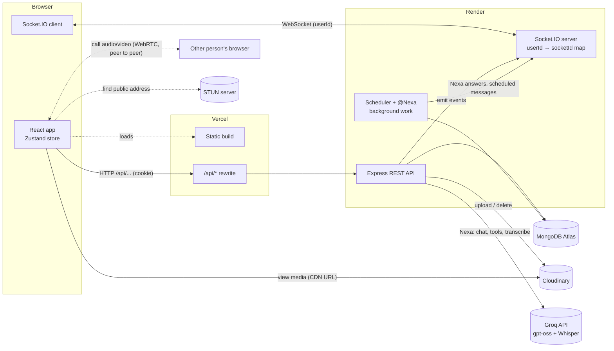
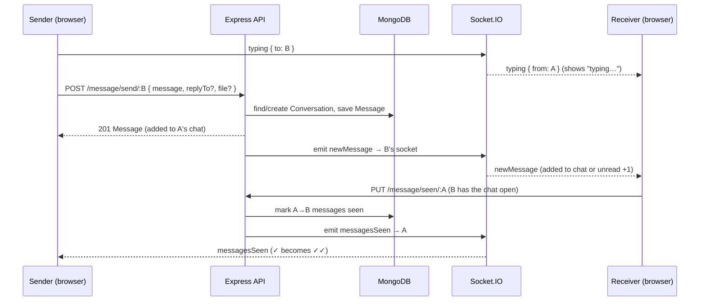
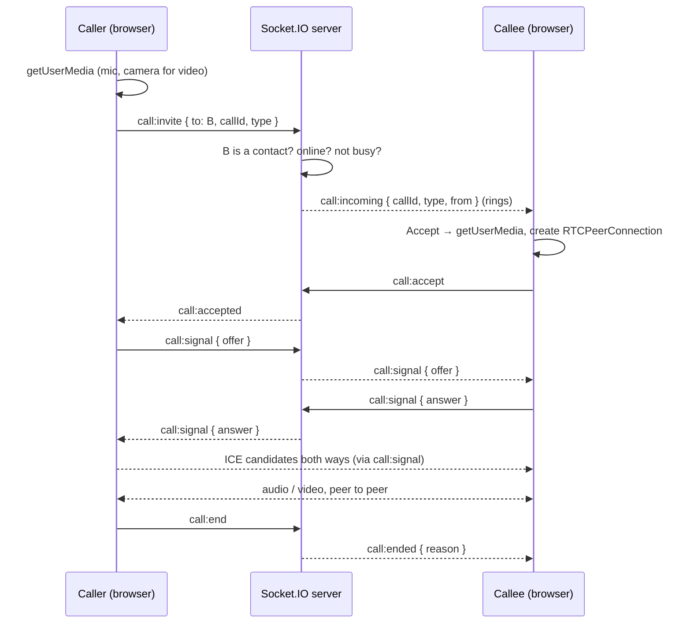
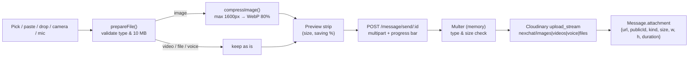
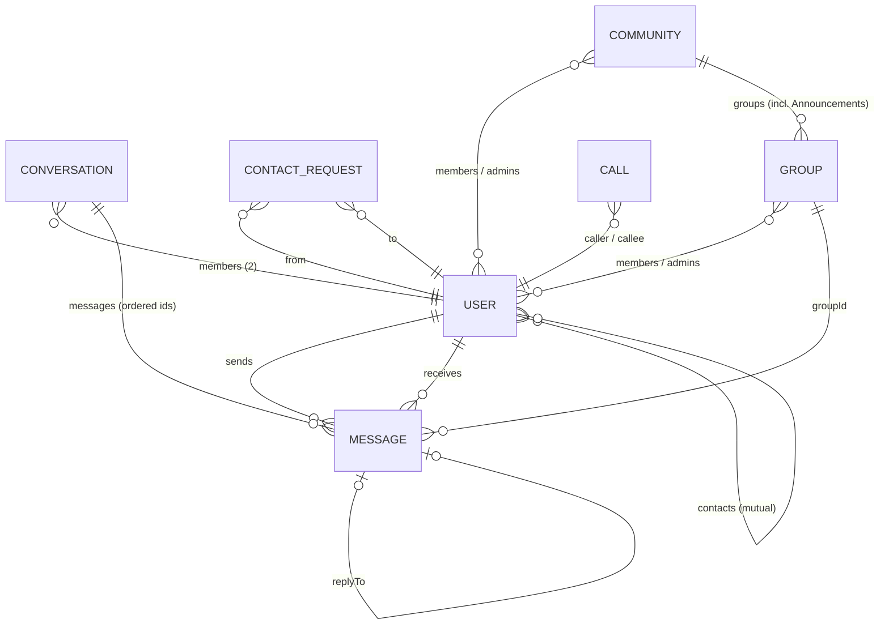

# NexChat

**A real-time messenger built with React, Node.js, Socket.IO, MongoDB and Cloudinary.**

NexChat is a full-stack chat application with instant delivery, a built-in AI assistant, group chats and communities, voice and video calls, private contacts (added by username or QR code), live presence, typing indicators, read receipts, replies, emoji reactions, editing, forwarding, voice notes, camera capture, photo and file sharing, notes to self, profile photos, and dark/light themes. It is designed to feel like a native messenger in the browser while staying within free hosting tiers.

| Service | URL |
|---|---|
| Frontend (Vercel) | https://kova-im.vercel.app |
| Backend API (Oracle Cloud) | https://kova.137-23-46-155.sslip.io |
| Repository | https://github.com/Arjun-SN04/NexChat |

---

## Contents

1. [Features](#features)
2. [Tech stack](#tech-stack)
3. [Architecture](#architecture)
4. [How it works](#how-it-works)
5. [Data model](#data-model)
6. [API reference](#api-reference)
7. [Real-time events](#real-time-events)
8. [Project structure](#project-structure)
9. [Getting started](#getting-started)
10. [Deployment](#deployment)
11. [Security](#security)
12. [Limits and known trade-offs](#limits-and-known-trade-offs)
13. [Roadmap](#roadmap)

---

## Features

### Messaging
- **Real-time delivery** over WebSockets (Socket.IO). Messages appear instantly for both people.
- **Replies** to a specific message, shown as a quote. Clicking the quote scrolls to the original and highlights it.
- **Editing** in the main input box (the message is highlighted while you edit). Allowed for **10 minutes** after sending, enforced on the server.
- **Deleting** a single message, several at once, or a whole conversation. Every delete asks for confirmation.
- **Emoji picker** in the composer with every emoji, search, categories and skin tones. Emoji are inserted at the cursor.
- **Reactions** with any emoji: quick picks, a longer list, or the full picker (one reaction per person per message).
- **Message actions**: hovering a message shows a small bar with **React**, **Reply** and **⋯ More** (Copy, Forward, Translate, Remind me, Edit, Select, Delete). With a mouse, clicking a message doesn't pin the bar; on touch screens a tap shows it and tapping elsewhere hides it.
- **Forwarding** one or many messages to up to 20 people at once. Forwarded messages are labelled.
- **Multi-select** mode (⋯ More → Select, or long-press on touch) to copy, forward or delete several messages.
- **Copy** message text from the ⋯ More menu.
- **Message grouping**: consecutive messages from the same person within 5 minutes are grouped, with date dividers ("Today", "Yesterday", or the date).
- **Link previews**: the first link in a message gets a card with the page's title, description, image and site name (Open Graph tags), fetched by the server after sending. Only public web pages are fetched; links to private or local addresses are skipped. Links in messages are clickable. Code: `backend/utils/linkPreview.js`, `rightPart/LinkPreview.jsx`.
- **Search all chats**: typing in the chat-list search also shows a **Messages** section with matches from every chat (text, voice-note transcripts, file names); tapping one opens the chat at that message. Locked and hidden chats are left out. `GET /message/search?q=`.
- **Location**: + → Location sends where you are now, or **live location** for 15 minutes, 1 hour or 8 hours. The map (OpenStreetMap via Leaflet) moves as the sender's position updates every ~10 s; the sender can stop any time, and live shares carry on after a page refresh. Code: `home/location/`, `utils/liveLocation.js`, `backend/controller/location.controller.js`.

### Media
- **YouTube videos play in the chat**: any YouTube link (watch, youtu.be, Shorts, YouTube Music, with start times) shows as a thumbnail with a play button, and tapping it plays the video right there in the message. Tapping the YouTube link (or a YouTube source chip under a Nexa answer) plays it in that message's card too. One video plays at a time. Leaving the chat while a video plays (switching chats, opening settings) hands it to the floating player from the same second, so it keeps playing like the voice-note bar; clearing the chat or deleting that message just stops it. **Pop out** on a playing video moves it to a small floating player in the corner (drag it anywhere by its title bar, remembered on this device; double-click the bar to put it back in the corner) and has a **Back to chat** button that returns to the chat the video came from, where its card takes over from the same second (if that message isn't on screen, the video keeps playing in the floating player) and carries on from the same second (the in-chat player reports its position through the YouTube embed API, `enablejsapi`) (bigger with the expand button), which sits above the whole app so it keeps playing while you switch chats or open settings. Works in one-to-one and group chats, @Nexa answers, channel posts and the Nexa chat. Ctrl/Cmd-click opens YouTube in a new tab. In Nexa's answers every YouTube link is first checked with YouTube (oEmbed, no key needed, `backend/utils/youtube.js`): links to removed, private or made-up videos are unlinked and dropped from the sources, so you never get YouTube's grey placeholder, and the card shows the video's real title. Videos whose owner turned off embedding keep their link but get no card. Nexa respects what you rule out: "not unplg", "without the remix", "not a cover" (in your message or the one before) are matched against the videos' real titles (so "unplg" matches "UNPLG'd"), those videos are dropped, and the card is picked from all the search results instead. Official uploads are preferred, and covers, remixes, slowed/reverb, lofi, karaoke and "version" uploads go last unless you asked for one. Uses the privacy-friendly `youtube-nocookie.com` embed. Code: `components/YouTubeCard.jsx`, `components/VideoPlayer.jsx`, `utils/youtube.js`, `Zustand/useVideoPlayer.js`.
- **Photos, videos and documents** (PDF, Word, Excel, PowerPoint, text, CSV, zip) up to 10 MB. Attach with the paperclip, paste from the clipboard, or drag and drop onto the chat.
- **Camera capture**: take a photo with the device camera (front/back switch on phones), retake or use it.
- **Voice notes**: record up to 2 minutes from the microphone, with an inline player (play/pause, seek, duration).
- **In-browser image compression** before upload (typically 90%+ smaller).
- **GIFs and stickers** in every chat and group (the smiley in the message box opens Emoji · GIFs · Stickers). GIF search goes through the server (`/api/gifs/search`) to **KLIPY** (`KLIPY_API_KEY`, preferred; Tenor's API shut down in June 2026) or **GIPHY** (`GIPHY_API_KEY`). Stickers include Google's animated Noto emoji (no key needed), online stickers when searching (with a key), and your own. A GIF or sticker is sent as a message with `media: { kind, url, title, width, height }`; the server only accepts URLs from the GIF provider, Google's emoji, or our own sticker uploads, and stores them with no `publicId`, so deleting a message never deletes the shared file. Stickers show without a bubble; GIFs get a small GIF label. Code: `backend/controller/gif.controller.js`, `home/media/MediaPicker.jsx`.
- **Saved and custom stickers**: save a sticker or GIF from a message's ⋯ menu, or with the bookmark in the picker (up to 150, in `User.stickers`). **Create** (Stickers → Yours, or ⋯ → *Make sticker* on any photo) opens a sticker maker: move and zoom the photo, pick Original / Rounded / Circle, a white outline that follows the shape (or a PNG's see-through edges), and a meme-style caption at the top or bottom. It renders a 512×512 WebP in the browser and uploads it to Cloudinary (`stickers/`). Removing a sticker you made deletes its file only once no message uses it. Code: `home/media/StickerMaker.jsx`, `Zustand/useStickers.js`, `GET/POST /api/gifs/stickers`, `POST /api/gifs/stickers/save`, `DELETE /api/gifs/stickers/:id`.
- **Delete for me / for everyone**: deleting a message, a selection, media from the media manager, or clearing a chat asks which one you want. "For everyone" is offered when every message is yours (or a Nexa answer you may remove) and frees the files on Cloudinary. "For me" hides it from your view only (`hiddenFor` on the message, never sent to other people). Once everyone in the chat has deleted a message for themselves, it's removed for good and its file freed. Code: `POST /api/message/delete-for-me`, `DELETE /api/message/conversation/:id?for=me`, `home/DeleteChoiceDialog.jsx`.
- **Download / Save as…** in the ⋯ menu of every photo, video, voice note and file. Save as lets you choose the folder and name in Chrome and Edge.
- **Media, links and docs**: open a chat's Contact or Group info (or the photos button at the top of the Nexa chat) to see every photo, video, document, link and voice note in that chat, grouped by month in tabs. Open photos full screen with previous / next, download, jump to the message, or select several to download or delete. Deleting removes the messages for everyone and frees the files on Cloudinary (you can only delete what you sent). In Nexa, deleting a photo or file removes just that file and keeps the message text. Code: `home/media/MediaManager.jsx`, `MediaSummary.jsx`, `utils/mediaItems.js`, and `DELETE /api/ai/messages/:id/file`.
- **Contact info panel**: profile, Audio / Video / Search buttons, media preview, details with a copy button for the username, chat settings, and a separate section for clear, remove, block and report.
- **Full-screen photo viewer**, with a **Download** button. Photos in chat also show a download button on hover (always visible on touch screens). Downloads fetch the file first, so they save instead of opening a new tab.

### Nexa, the AI assistant
- **Nexa's brain**: chat answers, tools, @Nexa in chats, poems and summaries run on **Groq** (`GROQ_MODEL`, default `openai/gpt-oss-120b`, then `gpt-oss-20b`), which answers a turn in about half a second; app tasks take 1 to 4 seconds. Groq also handles web searches, photo reading (vision model), voice-note transcripts (Whisper) and the Listen voice (Orpheus). **Gemini** (`GEMINI_API_KEY`) is only a last resort for chat when every Groq key is busy, because its free tier queues for 8 to 60 seconds a reply (and only before any tool calls, since Gemini can't continue a Groq tool conversation).
- **Understanding the request** (`utils/router.js`): before answering, a small fast model (Groq `gpt-oss-20b`, about half a second) reads the message and the last few lines of the chat and picks what kind of request it is: *write* (new poem, song, shayari, story), *image*, *web* (find a song or video, YouTube links, news, prices, weather, scores, places), *message* (send, schedule, remind, poll, summarise a chat), *calendar*, *email*, *business*, *groups*, *account*, *help* or *chat*. Nexa then gets the tools and instructions for that kind of request: a web request is told to search first and answer with real links ("find the song Memories in yt" gives the official YouTube video), and only real requests for new poems or songs go to the poem writer (before, any message with "song" in it did). Clear search words ("find", "play", "lyrics of", "youtube", "price of", "trailer") always mean a web search. If the router can't be reached (network trouble, busy), clear search wording still means a web search, and the poem writer never takes "lyrics of…" / "the song above" requests unless you ask it to write. The keyword checks are the fallback when the router can't decide, and @Nexa in chats uses the same router. Tested on 27 varied requests: 26 routed right (the miss still worked).
- **Lyrics and other things Nexa can't paste**: song lyrics are copyrighted, so Nexa never prints them, but it never just refuses either. It works out the exact song: Nexa's memory of the chat includes the YouTube video it showed (by its real title), so "the song above" means that video and not a similar title ("Paaro" isn't "Paro"). It searches for that exact title, and answers with links to the lyrics on proper sites (Genius, Musixmatch, JioSaavn, Spotify…), a line on what the song is about (only from the pages found, never guessed), and the artist, album and year. A lyric video for the song often comes up as the video card, which shows the lyrics while it plays. If a reply is still only "Sorry, I can't…", the server asks once more with instructions to help (search and give links). **Links in Nexa's answers are checked**: a link that came from the search is kept; one the model wrote itself points to the search result from the same site if there is one, or is kept only if the page really opens (a quick check); otherwise only its text stays. Pirate sites are never linked.
- **Nexa keeps working when you leave the chat**: the question runs to the end on the server even if you open another chat, Settings or reload. The answer is pushed live (`nexaMessage`), the Nexa chat shows "thinking…" again when you come back (`busy` in `GET /api/ai/messages`, live `nexaBusy`), and changes Nexa made (new group, business switched on, profile) refresh the screen wherever you are (`utils/nexaRefresh.js`, called from the global socket listener).
- **Nexa** is a built-in assistant pinned in the chat list (under "Message yourself"). Ask how to use NexChat, or anything else: writing a message, ideas, explanations, summaries.
- Answers come as short bullet points (drafts to send come as a quote you can copy). Nexa never uses em or en dashes. The chat looks like any other NexChat conversation.
- **Poems, songs and shayari**: Nexa writes them through a separate path (`utils/creative.js`). It writes three drafts at once, built around one specific moment, with planned rhymes and short lines. A checker scores each one for missing rhymes, repeated end words, overused words and long lines, and an editor pass fixes those exact problems on the best draft (up to two rounds). It answers in the script you typed in (Roman Hindi stays Roman) and only writes original pieces, never existing lyrics. Other answers pick their own format: verses, paragraphs, bullets or a short sentence.
- **Listen**: **Listen** under any Nexa answer, and in the ⋯ menu of any message with text or a transcript, reads it aloud with an expressive voice: Groq's Orpheus model (`utils/tts.js`, `POST /api/ai/speak`). A quick plan picks a female or male voice and a mood for each line (warm, tender, longing, cheerful…). The text is spoken in pieces under 200 characters that are joined with natural pauses, and recent audio is cached. Limit: 40 per person per hour. Hindi in Devanagari, or a server without Orpheus enabled, falls back to the device's own voices (`utils/speak.js`). Orpheus must be enabled once on the Groq account: open https://console.groq.com/playground?model=canopylabs%2Forpheus-v1-english and accept the terms.
- **Pinned messages**: up to 10 per chat. Pinning an 11th unpins the oldest. A pin button with a count sits next to the call buttons in the chat header. It opens a compact bar (tap to jump through the pins), and the chevron expands it into a list of every pin, each with jump and unpin. It closes when you switch chats.
- **Image model picker**: the magic-wand button at the top of the Nexa chat (or ⋯ on phones) chooses which model Nexa draws with: **Auto**, **FLUX.2 Klein** (best detail, any shape), **FLUX.1 Schnell** (fastest) or the free **Magic** backup. Only models this server can use are listed. The choice applies to the Nexa chat and @Nexa, and each picture shows which model made it. **A picked model is the only one used**: if it fails (busy, daily limit), Nexa retries it once and then says why, with a Try again button, instead of quietly drawing with another model. **Auto** tries the models in order so you always get a picture. (Gemini isn't used for images: free Gemini keys have no image quota.)
- **Nexa never refuses a picture**: if a reply says it can't make images, the server draws it anyway (from Nexa's prompt, or your own words), and that line never reaches the chat. Send a photo with "make this a cartoon" or "make this more natural and clean" and Nexa **edits that photo**: the photo itself goes to FLUX.2 Klein as a reference (`input_image_0`, up to 1024 px, same proportions as the photo) with an instruction to keep the same person (face, features, skin tone, hair, expression), pose, clothes and background unless asked otherwise. Follow-ups like "make it brighter" edit the last picture (the model sets `edit_previous`), and `@Nexa make this a cartoon` on a photo in any chat works the same way. Photo edits always use **FLUX.2 Klein 9B** (`CLOUDFLARE_EDIT_MODEL`), whichever model is picked: in a side-by-side test it kept the face closest to the photo and was the quickest (about 3.5 s), while Klein 4B smoothed and changed the face and FLUX.2 Dev reshaped it. FLUX.2 Klein 4B is the backup; if it fails, Nexa says so instead of drawing a different person. Only when no editing model is set up does it fall back to describing the photo. Code: `generateImage(..., { referenceUrl, editPrompt })` and `editInstruction()` in `utils/imageGen.js`.
- **Pictures on the first ask**: Nexa understands picture requests in any wording, with typos ("genrate an iamge"), and as follow-ups ("yes do it", "make it blue", "one more"), both in the Nexa chat and with @Nexa / Nexa mode. Clear requests go straight to the image tool; unclear ones get a quick yes/no check from the model with the recent chat as context. If Nexa still answers "I can't create images", the server makes the picture anyway. Earlier image prompts are kept in Nexa's memory, so changes build on the last picture. Code: `utils/imageIntent.js`.
- **Message menu in the Nexa chat**: right-click a message (or long-press on a phone) for its actions, opened where you clicked: Nexa's answers have Reply, Copy, Listen, Regenerate, Keep and Delete; your questions have Copy, Edit, Keep and Delete (Delete asks first). Under each message there's only the time, plus Kept / Copied and a Stop button while it's being read aloud. Code: `home/ai/MessageMenu.jsx`, `hooks/useMessageMenu.js`.
- **Nexa chat tools** (same as in normal chats): the pen button rewrites your question (with Undo), the mic does **voice typing** (your words land in the box to check before sending; `POST /api/ai/dictate`, Groq Whisper, audio isn't stored), **Reply** on an answer sends your question with a quote of it, **Regenerate** on the latest answer asks again, **Copy** and **Edit** under your own questions, and you can drop a photo or document anywhere on the chat.
- **Message history like a terminal**: in the Nexa box, **↑** brings back your earlier questions (newest first) and **↓** goes forward, ending on what you were typing. Normal chats work the same way with the messages you sent in that chat (edit a message from its ⋯ menu). Shared hook: `hooks/useInputHistory.js`.
- Opening Nexa with an empty chat shows a short greeting and eight starter suggestions (send, schedule, remind, catch up, search the web, create an image, set up a business, make a group). Ask **"What can you do?"** to see all sixteen, plus a note on what Nexa adds to every chat. Tapping an example puts it in the box to edit before sending. It remembers the conversation, so follow-up questions work. The chat is private to you and can be cleared.
- **Nexa can act for you** (ask in plain words):
  - *Send a message*: "tell Arjun I'm running 10 minutes late".
  - *Schedule a message*: "wish Priya happy birthday tomorrow at 9am". Times use your own time zone.
  - *Reminders*: "remind me at 6pm to call mom" (arrives in your Message yourself chat).
  - *List or cancel* scheduled messages: "what do I have scheduled?", "cancel the birthday one".
  - *Catch up*: "summarize my chat with Arjun" or a group.
  - Each action shows a card in the chat (Scheduled / Sent / Cancelled) with **Cancel** and **Open chat**.
- **Nexa runs the app for you**: say what you want and Nexa does it, instead of explaining where the buttons are. One message can ask for several things ("create a business account for my bakery Sweet Crumbs, open 9 to 8, closed Sunday, UPI arjun@okhdfc, and add chocolate cake for 650"); Nexa does each step, then sums up and suggests a next step.
  - *Business*: create or turn on the business account (name, category, description, address, website, email, UPI ID, opening hours like "9am-8pm, closed Sunday"), request verification, switch back to personal; greeting and away messages, Nexa auto-reply, lead detection, daily summary, unanswered alert; quick replies, FAQ, services, discount codes, labels and templates; add, edit or remove catalog items (several at once); list orders and change their status or paid flag (the customer is told); list bookings and mark them done or cancelled; add or remove staff; broadcast to all customers or one label; insights.
  - *Groups, communities, channels*: create a group with contacts by name, rename it, change its description, admins-only and join approval, add or remove people, make or remove admins, get its invite link, add a group task or event, leave or delete it. Create a community, add people or a group to it, leave or delete it. Create a channel, post to it, follow or unfollow channels.
  - *Account*: change your name, about or @username; privacy (last seen, read receipts, who sees your photo and about, who can add you to groups); add a contact by @username, accept or decline requests, remove, block or unblock someone, get your invite link; disappearing messages and pinning per chat; post a text status.
  - **Asks before anything hard to undo**: deleting, removing people, blocking and broadcasting (switching the business to personal keeps everything, so it just happens). Nexa asks "Shall I …?" and goes ahead when your next message is anything but a no ("yes", "go ahead", or repeating what you want); it stops at the question instead of retrying.
  - **Acts first**: "create a business account for me" creates it straight away (category from your words, or Other), then asks for the name and details. A business name is only used if you actually wrote it. The server enforces this (the model can't confirm on its own) and replies with the exact question, so Nexa never says something was done when it wasn't.
  - Nexa can't change passwords, upload photos, delete your account or pay; it tells you where to do those.
  - Each change shows a card (what changed, with **Open chat** or **Open business**), and the rest of the screen (chat list, groups, communities, channels, contacts, your profile) refreshes right away.
- **Nexa in your chats** (no need to open Nexa):
  - *Smart replies*: 2–3 one-tap replies above the message box for the last message someone sent you.
  - *Catch me up*: open a chat with 5+ unread messages and a "Catch me up · 9 new" button appears in the header; tap it for a short summary of what you missed and what needs your reply.
  - *Translate*: from a message's ⋯ menu, into your browser's language, shown under the original (or "Already in English").
  - *Transcribe*: voice notes get a Transcribe button (Groq Whisper). The text is saved, so everyone in the chat sees it and summaries include it.
  - *Remind me*: from a message's ⋯ menu: in 1 hour, in 3 hours, tomorrow 9 AM, or a custom time. The reminder arrives in your Message yourself chat with **Go to message**.
  - *Nexa mode*: type `@Nexa` once in any chat (on its own, or with a question) and the chat switches to Nexa mode: a violet bar above the message box shows it's on, and every message you send goes to Nexa (no need to type `@Nexa` again) until you type **exit** (or tap Exit, or press Esc on an empty box). The mode is remembered per chat on this device. Messages sent this way show a small "to Nexa" tag for everyone, and questions sent quickly in a row are answered in order instead of being dropped. Code: `nexaMode` in `Zustand/UserConversation.js`, `TypeSent.jsx`, `askNexa` / `toNexa` in `message.controller.js` and `group.controller.js`.
  - *@Nexa in any chat*: type `@Nexa` (a suggestion pops up after `@`) and Nexa answers right there as a reply. In a group everyone sees it ("@Nexa pick a restaurant from what we said"); in a one-to-one chat both people see it ("@Nexa what does this word mean?"); in Message yourself it's just for you. As soon as you send it, a **"Nexa is thinking…"** bubble (and header and chat-list status) appears for you and the other person until the answer arrives. Nexa's bullets are formatted in the chat.
- **Rewrite with Nexa** (pen button in every chat's message box), with **Undo**. Length: *Shorten*, *Elaborate*, *Make it a list*. Tone: *More professional*, *Friendlier*, *Casual*, *More confident*, *More polite*, *Funnier*. Fix: *Spelling & grammar*, *Simpler words*, *Add emoji*. Translate: *English*, *Hindi*, *Hinglish*, *Malayalam*. Or type your own request ("sound excited"), sent as style `custom` and treated only as a rewrite instruction. Code: `home/rightPart/RewriteMenu.jsx`, `STYLES` in `ai.controller.js`.
- **Scheduled bar**: a chat with scheduled messages shows "2 scheduled messages · next Fri 9:00 AM" above the message box, with the list and Cancel buttons.
- Powered by **Groq**'s free API (`openai/gpt-oss-120b`, falling back to `openai/gpt-oss-20b`). The API keys stay on the server.

### Groups and communities
- **Groups**: create a group from your contacts with a name and description. Everything works in groups: replies, reactions, files, voice notes, edit/delete/forward, and typing ("Priya is typing…"). Each message shows who sent it.
- **Admins** can rename the group, add contacts, remove people, and make others admin. Anyone can leave; the group always keeps at least one admin.
- **Communities** bring related groups together. Creating one adds an **Announcements** group where only admins post and every member is included. Admins add people and create groups inside the community; members see all its groups and can **join** any of them.
- **Only admins can send messages**: a switch in group info for any group. Members can still read, react and vote; the message box says why it's closed.
- **Invite links with join requests**: admins share a link (`/g/<code>`, copy / share / reset / turn off). With **Approve new members** on, people who open it ask to join and admins approve or decline them in group info.
- **Events**: **+** → Event in a group posts an event card (date, time, place, details). Members answer **Going / Maybe / Can't go**, the card shows who's going, anyone can **add it to their calendar** (.ics), and the group gets a reminder an hour before. The organiser or an admin can cancel it.
- **Group invites for people who approve adds**: someone whose privacy says "Only with my approval" gets an invite with Join / Decline instead of being added directly; group info shows how many invites are waiting.
- Groups and communities appear in the chat list and in a **Groups** tab (each community with its groups underneath). Unread counts, previews and changes (new groups, renames, members joining or leaving) update live.
- **Channels** (new Channels tab): one-way updates. Anyone can create a channel with a name, @handle and description; admins post text, photos and videos (with link previews); followers read and react. Find channels by name or handle, follow / unfollow, unread counts, "Copy channel link" (`/?channel=handle`), edit picture/name/description, delete posts or the whole channel. Code: `home/channels/`, `backend/controller/channel.controller.js`, models `Channel` and `ChannelPost`.

### Calls
- **One-to-one voice and video calls** with any contact, started from the chat header.
- **Full-screen call view**: incoming call with Accept / Decline and a ringtone, "Calling…" with a ringback tone, then a running timer.
- **In-call controls**: mute, camera on/off, hang up. Video calls show the other person full screen and your camera in a corner.
- **Clear outcomes**: declined, no answer (30 s), missed, offline, busy (already on a call), couldn't connect, or microphone/camera blocked.
- Audio and video go **directly between the two browsers** (WebRTC); the server only rings and passes connection details.
- **Add people to any call**: the **Add people** button (voice and video) rings more people, up to 8 in a call. In a one-to-one call you pick from your contacts and the call moves into a group call for everyone, with no hang-up. In a group call you ring members who aren't in it yet. People who are added get a "added you to a call" banner with Join / Decline. Server: `gcall:upgrade` and `gcall:add` in `socket/groupCalls.js` (ad-hoc calls are keyed `room:<id>` and only invited people can join).
- **In-call tools** (one-to-one and group): **Minimise** the call into a small floating card you can drag around while you keep chatting; **Share screen** (video calls on desktop) and **Flip camera** (phones); tap the small video to **swap** it with the big one, or tap a tile in a group call to enlarge it. Everyone sees when someone is **muted**, has their camera off or is sharing, a green ring shows **who's talking**, and "Priya joined / left" notes pop up. Video-call controls fade after 5 s and come back on a tap. Code: `home/call/`, `utils/callMedia.js`.
- **Call history in the chat**: every call appears in the conversation as a call bubble ("Missed voice call", "Video call · 3:12", "Voice call · No answer") with a call-back button, and in the chat list preview. Missed calls count as unread.
- **Calls tab**: a recent-calls list (incoming, outgoing, missed, with duration), grouping repeated calls ("Missed (2)"), search, call-back buttons, a **New call** picker, and "Clear call log". A badge shows missed calls you haven't looked at yet.

### Presence and status
- **Online indicators** for every contact, and **last active** ("Active 5 min ago", "Active yesterday at 9:12 PM") in the chat header when they're offline.
- **Typing indicator** in the chat header, the contact list, and as an animated bubble in the chat.
- **Read receipts**: ✓ sent, ✓✓ seen (updates live when the other person opens the chat).
- **Unread counts** per contact and in the browser tab title, stored on the server so they survive a reload.

### Contacts and privacy
- **Contacts only**: you only see, message and call people in your contacts. Nobody can browse everyone who signed up.
- **Usernames**: every account has a unique `@username`, chosen at sign-up and editable in Profile.
- **Add by username**: send a contact request; the other person accepts or declines it. Requests arrive live, with a badge and a banner.
- **Invite link and QR code**: share your link or QR code (copy, share, WhatsApp, or save the QR image). Opening it adds you to each other instantly. The link can be reset at any time.
- **Remove contact** from the contact info panel (chat history is kept).
- **Block and report** from the contact info panel. Blocking removes the contact both ways and stops new requests, invites and messages; unblock in Profile → Blocked accounts. Reports (spam, scam, abuse) go to the app admins.
- **Message yourself**: a private chat pinned at the top for notes, links and files.
- **Who can see my photo / about**: Everyone, My contacts, or Nobody (Profile → Privacy). Applied wherever your profile goes out (contacts, search, groups, invites). Business logos stay public.
- **About**: a short line on your profile (up to 140 characters), shown in contact info.
- **Who can add me to groups**: My contacts, or Only with my approval (you get an invite to accept).
- **Locked chats**: lock chats behind a secret code (4 to 10 digits, or 4 to 16 letters and numbers; set the first time). They look like any other chat in the list; opening one asks for the code and nothing loads until it's entered. After the code is entered, locked chats stay open for a time you choose in Profile → Locked chats → **Ask for the code again**: every time, after 1, 5 (default), 15 or 30 minutes, after 1 hour, or until Kova closes (opening a locked chat restarts the time; the choice is saved on this device). A page refresh always asks again. Their notifications just say "New message". Code fields have an eye button to show what you type. Change it in Profile → Locked chats (asks for the current code). Forgot the code? Answer your **security question** (or, if you never set one, enter your account password) and choose a new code. Nothing is deleted. The code dialogs show the photo of the chat being opened or locked. 5 wrong tries pause for 5 minutes.
- **Hidden chats**: hide any chat (⋯ → Hide chat, or select chats → Hide). Hidden chats leave the chat list, search, Contacts and unread badges, and their notifications say "New message". Typing your secret word in the chat search box shows them (capitals don't matter); clearing the search hides them again. Set, change or turn off the word in Profile → Hidden chats; changing or turning it off asks for the current word, or your security question answer if you forgot it. The server keeps only a SHA-256 of the word, never the word itself.
- **App lock**: a PIN (4–10 digits, or 4–16 letters and numbers) to open Kova on this device, asking again (Profile → App lock → **Ask for the PIN again**) immediately, after 1, 5, 15 or 30 minutes, 1 or 4 hours away from Kova, or only when Kova reopens, with optional **fingerprint / face / device unlock** (WebAuthn). "Forgot PIN?" resets it with your security question answer (or log out, which removes the lock). When setting the app PIN or the chat lock code, a **"use this for both"** checkbox sets the other one to the same code.
- **Security question**: chosen from a list or written yourself, set when you create your first chat lock code or in Profile → Locked chats (changing it asks for your account password). Only a bcrypt hash of the answer is stored; capitals and extra spaces don't matter. 5 wrong answers pause resets for 15 minutes (`backend/utils/recovery.js`).
- **Security dialogs** (lock code, secret word, app PIN, security question) share one design: a photo with a lock badge, a 123 / Abc 123 switch for the code type. Code: `components/security/`.
- **Forgot password** (login page): emails a 6-digit code (expires in 10 minutes, 5 tries, one resend per minute), then you choose a new password. The form never says whether an email has an account. Code: `components/ForgotPassword.jsx`, `backend/utils/securityCode.js`, `backend/utils/mailer.js`.
- **Chat list = real chats**: people show in the list once you have a chat with them (or it's pinned, unread or open). Deleting a chat removes them from the list. **Contacts** (the address-book icon at the top) lists everyone you're connected to, with search, **Message** (they come back to the list) and **Remove** (disconnects you both; history isn't deleted). Searching the chat list also finds contacts without a chat.
- **Voice notes keep playing**: one app-wide player. While a voice note plays, a bar at the top shows who it's from, a seekable progress bar, 1× / 1.5× / 2× speed and ×; it keeps playing when you switch chats, and clicking the title jumps back to the message.
- **Previous business**: after switching to a personal account, the Business setup page shows your old business (cover, category, how many items, orders, bookings and customers) with **Switch back to this business** (everything comes back) or **Delete**. Deleting removes the catalog, customer notes and labels, settings, team, cover photo and payment QR for good; orders and bookings stay in customers' history. You can also switch back with a new category or description. `DELETE /api/business/me`; `GET /api/business/me` returns `previous`.
- **Payment QR**: Business → Settings → Profile & hours → **Payment QR code**: upload the QR from any UPI, bank or wallet app, with an optional label ("GPay · PhonePe · Paytm"). Customers see a **Scan QR** button on payment requests in chat and a **Pay** card on the business page (with Pay with UPI and copy UPI ID). With no QR uploaded but a UPI ID set, Kova makes a UPI QR automatically, with the amount filled in on payment requests. `PUT /api/business/payment-qr`, stored as `business.paymentQr`.
- **Switch back to a personal account**: Profile → Business tools, or Business → Settings → Profile & hours. Turns the business page, badge, ordering and bookings off; the catalog, orders and settings are kept for later.
- **Select chats**: right-click (or long-press on touch, or the select button) to pick several chats, then **Pin**, **Mark read**, **Lock** or **Delete** them together.

### Navigation
- **Fewer header buttons**: the Chats header has two buttons: **✎ New** (New group, New community, Add contact) and **⋯ More** (Contacts, Contact requests with a count, and on phones Business and Light/Dark mode, which computers keep in the left rail); ⋯ shows a badge for new requests. In a chat on a phone, the pinned-messages button moves into the chat's ⋯ menu as "Pinned messages (N)"; computers keep the 📌 icon. Shared menu: `components/HeaderMenu.jsx`.
- **Collapsible chat list** (computers): the panel button in the left rail, or **Ctrl/Cmd+B**, hides the chat list so the open chat gets more room; the section rail stays with all its icons and badges. Clicking any section in the rail (or the panel button / Ctrl+B again) brings the list back, and it stays until you collapse it again; opening chats never changes it. Remembered on this device (`Zustand/useSidebar.js`). Phones keep their usual layout.
- **Close chat** in a chat's ⋯ menu closes it and goes back to the empty screen (on phones, back to the chat list). The header's status line stays on one clean line: on phones a short form ("Active 11:56 AM", and for a business "· ● Closed" with a green or grey dot), on bigger screens the full one ("Active today at 11:56 AM · Closed · opens tomorrow 9 AM").
- **Settings page** (`/profile`): a menu on the left (search, your photo and name, then **Profile**, **Account**, **Privacy**, **Security & locks**, **Chats**, **Notifications**, and **Log out**) and the chosen section on the right. On phones the menu shows first and a section opens full screen with a back arrow. The open section is kept in the URL (`/profile?s=privacy`), so refresh and the browser's back button work. Code: `components/Profile.jsx`.
- **Section rail** on the left (WhatsApp-style) with **Chats**, **Calls** and **Communities**, each with a badge (unread chats, new missed calls, unread community messages). Theme, settings, log out and your profile sit at the bottom. On phones it becomes a bottom tab bar.
- **Communities tab**: each community with its Announcements preview and unread count, plus "View all" to open the community.
- Contact list with **last message preview** and time, sorted by most recent chat.
- **Search** (press `/` anywhere) and **All / Online / Unread / Groups** tabs. Nexa is pinned under Message yourself.
- **Contact info panel** (username, email, join date, clear chat, remove contact).
- **Welcome screen** with people who are online right now.
- **Jump to latest** button with a new-message counter when you scroll up.
- **Resizable sidebar**: starts at about a third of the window (400–500px), can be dragged from 360px up to 640px (or about half the window), and double-click resets it.
- **Responsive**: one panel at a time on phones, with back navigation.

### Business
Any account can turn on **Business** (Profile → Business tools, or the briefcase in the side rail) to talk to customers in one place. Setup is one screen: pick a category and add a short description (a photo for the chosen category shows alongside). The business workspace lives at `/business`; each section has a photo banner, and the sidebar shows the business's cover, its open status and a link to its public page.

- **Business profile**: category, description, address, website, email, UPI ID and opening hours (with time zone). Chats with a business show a briefcase (or a blue ✓ once **verified** by an app admin) and "Open now · closes 8 PM" / "Closed · opens Mon 9 AM" in the header.
- **Business page and QR code** (`/b/<username>`): a storefront with a **cover photo** (uploaded in Settings → Profile & hours, or a stock photo for the business's category), profile, hours, contact details, a photo catalog with a cart, the list of bookable services, **Book** and **Message**. Works signed out (sign in, then come back). Customers can message a business **without a contact request**; a contact request to a business is accepted at once.
- **Quick replies and templates**: type `/` in a customer chat to insert a saved answer (`/price`, `/hours`); `{name}` becomes the customer's first name. Templates (`{name}`, `{order}`, `{total}`, `{status}`) are used for order updates.
- **Greeting and away messages**: sent automatically on a customer's first message, and outside opening hours (at most every 6 hours per customer). They are marked "Automatic".
- **Chat labels**: coloured tags ("Pending payment", "VIP") on customer chats, with label, **Waiting** and **Leads** filters in the chat list.
- **Customer panel** (contact info and inbox): labels, lead flag, private notes, **follow-up reminder** (Nexa reminds you at the time), who handles them, **team-only notes**, and their orders.
- **Broadcast lists**: one message to many customers (a list, everyone with a label, or all), delivered as separate private chats.
- **Catalog**: items with photo, price, description and stock. Send any item in a chat as a **product card** (**+** in the message box → Send a product); customers tap "Ask about this" or open the shop.
- **Orders**: customers order from the business page; the order arrives as a card in the chat. The business changes the status (new → confirmed → ready → out for delivery → done) and the customer is told in the chat, with a template or the default text. **Order history** per customer and overall.
- **Discount codes**: Settings → Discount codes: % or ₹ off, minimum order, use limit, expiry, on/off, with a usage count. Customers apply a code in the cart; the server checks it again when the order is placed.
- **Order tracking page** (`/order/<id>`): timeline (placed → confirmed → ready / out for delivery → completed, or cancelled) with times, items with photos, discount and payment status. It updates live. Linked from the order card ("Track order") and from Business → Orders.
- **Reviews and ratings**: once an order is complete the customer rates it (1–5 stars + a comment) from the tracking page or the order card. The business page shows the average, the number of ratings and recent reviews (first name only); Business → Orders shows each order's rating.
- **Payment requests**: an amount (optionally for an order) as a card with **Pay with UPI** (deep link) and the UPI ID to copy. The customer taps "I've paid", the business confirms with "Mark as paid", and the order is marked paid.
- **Bookings**: services with a length and price; customers pick a day and a free slot (from opening hours, skipping booked times). Bookings appear in the chat as a card, in the Bookings screen, and in the business's Google Calendar with a Meet link when Google is connected. Customers get a reminder message the day before; either side can cancel.
- **Team and shared inbox**: add staff by username as **Admin** (inbox, catalog, settings) or **Agent** (inbox, customers, orders, bookings). They use their own accounts and reply **as the business** from the shared inbox (filters: unread, waiting, mine, unassigned, leads, needs a person). Chats can be **assigned** to a team member. Staff only see customer chats, never the owner's other chats.
- **Nexa for business**: optional **auto-reply** to customers from the profile, hours, catalog, services and FAQ (hands over to a person and marks "Needs a person" when unsure); **lead detection** (a Lead tag on likely sales); **smart replies** in a professional tone; and a **daily summary** at 9 AM in the Nexa chat (yesterday's customers, messages and orders, open orders, today's bookings, who's waiting, follow-ups due).
- **Insights**: messages in/out, new customers, average first-reply time, orders and revenue, bookings, per-day charts and busiest hours (7, 30 or 90 days). **Unanswered alerts** notify the team when a customer waits longer than a set time (default 15 minutes).
- **Export**: customers and orders as CSV files.
- **Group tasks**: in any group, ⋯ → **Make task** on a message (or Tasks in group info): assign it, add a due date, tick it off. A task card is posted in the chat and updates when it's done.

### Account
- **Username suggestions at sign-up**: as you type your name, free usernames appear under the Username field (e.g. `janecooper`, `jane.cooper`, `jane_cooper`, `jcooper`, `janecooper13`); tap one to use it, ↻ for more ideas. Accents are removed, non-Latin names fall back to the email, reserved names are skipped, and all candidates are checked in one database query. A live check shows ✓ available or ✗ taken for whatever you type. Code: `GET /api/user/username-suggestions?name=&email=`, `suggestUsernames` in `backend/utils/username.js`, `UsernameHelper` in `components/Signup.jsx`.
- Sign up, sign in, sign out (JWT in an HTTP-only cookie).
- **Stay signed in**: sessions last 30 days and renew automatically while you use the app. If a session does expire, the app returns to the sign-in page instead of showing empty data.
- **Profile photo** upload, change and remove (cropped and compressed in the browser).
- Change display name, username and password.
- **Dark theme by default**, with a light theme toggle in the app and on the landing page (remembered per browser).
- **Chat wallpapers**: pick a default for all chats in Profile → Appearance → Chat wallpaper, or a different one per chat (chat ⋯ menu → Wallpaper, or the chat's info panel). Choose from 51 presets (doodle patterns, textures like dots / grid / lines, soft colours, gradients and 18 photos, each with a light and a dark look), **upload your own photo**, or keep Classic. A **Dim** slider keeps messages readable, and photos get a little darker in dark mode. A chat can go back to "Use my default". Saved to your account (`User.wallpapers`), so they follow you to every device; uploaded photos are deleted from Cloudinary when no longer used.
- **Ask Nexa about photos and documents in any chat**: type `@Nexa` with a question in a one-to-one or group chat. Nexa looks at the photo or document (PDF, Word, TXT, CSV) you replied to, the one sent with the question, or the latest ones in the chat (up to 4 photos, 1 document). Photos use the vision model (`GROQ_VISION_MODEL`); documents are read and the relevant part is used. Each answer starts with **Looked at** chips (a thumbnail or the file name); click one to jump to it. If a document can't be opened, Nexa says so instead of guessing. **⋯ → Ask Nexa about this** on a photo or document starts a question for you.
- **@Nexa can create images and summaries in any chat**: "@Nexa create an image of our beach trip plan" turns the request (and the chat, if it refers to it) into a picture and posts it in the chat (10 per person per day; needs an image provider, see `utils/imageGen.js`, best is a free Cloudflare Workers AI key). "@Nexa summarise this chat" / "give a conclusion" / "recap" reads the last 150 messages and posts key points, decisions, to-dos and a conclusion.
- **Delete Nexa's answers**: in a one-to-one chat either person can delete them; in a group, the person who asked or an admin. They're removed for everyone in the chat.
- **Opening files**: PDFs and other files open through `GET /message/file/:messageId`, which checks you're in the chat and hands out a short-lived signed Cloudinary link (plain links to PDFs are blocked by Cloudinary on many accounts).
- **Reply suggestions**: up to 3 one-tap replies to the latest message someone sent you: a yes, a no or not now, and a follow-up question. They skip Nexa's answers, automatic messages and simple "ok" / "thanks" messages. Hide them with ×; bring them back with **✨ Suggestions** (remembered per device).
- **Send several files at once**: pick, paste or drop up to 10 photos, videos or documents together. They show as a strip of thumbnails (remove any, or add more), then go out as separate messages in order, with your text on the first. Progress shows "Sending 2 of 5".
- **One "+" menu in the message box** for photos and files, the camera, polls, and (for business accounts) sending a product, requesting a payment and quick replies. Emoji stays as its own button.
- **Privacy** (Profile → Privacy), both working both ways like WhatsApp:
  - **Activity status:** turn it off and nobody sees you online, and you don't see anyone else online. The server sends each person their own filtered online list.
  - **Seen indicators:** turn it off and people don't see the double tick when you've read their messages, and you don't see it on theirs. Messages are still marked read for unread counts; only the indicator is hidden.
  - Saved via `PUT /user/privacy { activity, seen }` in `User.privacy`.
- **Photo editor**: choosing a new profile or group photo opens an editor first, and **Edit photo** in Profile edits the current one. Drag to position, zoom (slider or scroll), straighten, rotate, flip, 7 filters (Vivid, Warm, Cool, Fade, Mono, Noir) and brightness / contrast / saturation, with a circle guide for how it looks as an avatar. Saved as a 512 px square. Clicking a profile or group photo opens it full size.
- **Copy or share your username** from Profile: **Copy** puts `@username` on the clipboard; **Share** opens the device's share sheet with your username and invite link (or copies that message where sharing isn't supported).
- **Account settings** use a two-column layout on wide screens: profile details, password and blocked accounts on the left; appearance, notifications and business tools on the right.
- **Notifications that always arrive**: push (`utils/push.js`) is sent by the server only while you're offline; while Kova is open but you're in another tab, app or chat, `utils/localNotify.js` shows a system notification from the live connection instead (same rules: locked/hidden chats say "New message", one per chat, clicking opens the chat). Turning on push retries once with a clean subscription, replaces subscriptions made with an old server key, and explains fixes: **Brave** blocks web push unless *Use Google services for push messaging* is on in `brave://settings/privacy` (with a copy button and steps, `components/PushHelp.jsx`).
- **Appearance settings** (Profile → Appearance): **Light, Dark or System** mode (System follows the device), and six colour themes: **Ocean** (blue, the default), **Iris** (violet), **Lagoon**, **Forest**, **Rose** and **Graphite**. The logo, the browser-tab icon and the mobile address bar follow the chosen theme. A theme recolours buttons, links, selected chats, your message bubbles and Nexa. It's saved per browser (`chatTheme`, `chatAccent`) and applied before the app loads, so pages don't flash. The palettes are in `index.css` (`:root[data-accent=…]` swaps Tailwind's `indigo` and `violet`).
- **Light mode**: soft off-white surfaces (not pure white) on clean cool greys, and the chat background is a soft wash of the theme colour so message bubbles stand out.
- **Graphite dark palette**: dark mode uses neutral greys instead of navy. `index.css` remaps every `slate-*` and `zinc-*` colour under `.dark`, so all screens follow one palette.
- **One dropdown style everywhere**: every dropdown uses the shared `Select` component (`components/ui/Select.jsx`) instead of the browser's own. Its menu opens above dialogs and scrolling panels, flips up when there's no room below, gets a search box for long lists (like time zones), and works with the keyboard (arrows, Enter, Escape, type to jump).
- **Download your data** (Profile → Your data & account): builds a ZIP in the background with your profile, contacts, every chat as text and JSON, the photos/videos/voice notes/files (up to 500 MB), Nexa history, statuses, channels and calls, then emails a download link that works for 24 hours (only while signed in). Code: `backend/utils/accountData.js`.
- **Delete account**: confirmed with your password or an emailed code. The account is signed out everywhere and deleted after 30 days; signing in before then cancels it ("Welcome back" banner). Deletion removes your chats, files, statuses, channels you own, business data and your place in groups/communities.
- **Email digest** (Profile → Notifications, off by default): at most once a day, when you have unread messages and haven't opened Kova for 12 hours, an email lists the chats with unread messages. Locked and hidden chats are never included.
- **Emails** share one dark design (`backend/utils/emailTemplates.js`): password reset code, account deletion code, export ready, deletion scheduled and the digest. An hourly job sends digests, removes expired exports and deletes accounts whose 30 days are up.

### Website
- Landing page in dark (default) and light, with a theme toggle: a centered hero with a wide photo, a feature showcase that cycles through the app's features over a photo, use-case photos, "how it works" steps, smooth scrolling (Lenis), parallax and scroll-in animations.
- **FAQ page** (`/faq`, linked from the landing page's top bar and footer): about 60 questions in 10 topics (getting started, messaging, media, Nexa, groups and channels, calls, status, privacy, business, account) explaining every feature and where to find it. Answers are laid out as numbered steps, bullet points and small headings, and every question has a **See an example** button that opens a short real-life walkthrough (e.g. a customer ordering a cake from a bakery, start to finish). Search box with highlighted matches, topic chips (a sticky list on desktop), expandable answers and shareable links to a question (`/faq#topic--question`). Answers live in `frontend/src/data/faq.js`, examples in `frontend/src/data/faqExamples.js` (keyed by question text).
- Animated page transitions, a page title per screen, and a custom favicon. The logo's three dots do a small typing wave on load and while hovered.

---

## Tech stack

### Frontend
| Technology | Purpose |
|---|---|
| React 19 + Vite 7 | UI and build tooling |
| Tailwind CSS v4 (+ daisyUI) | Styling, including a class-based dark mode variant |
| React Router 7 | Routing |
| Zustand | Global chat state (open chat, messages, unread counts, typing, selection, etc.) |
| Socket.IO client | Real-time connection |
| Axios | HTTP requests (with upload progress) |
| React Hook Form | Form validation |
| Motion (Framer Motion) | Page transitions, dialogs and UI animation |
| Lenis | Smooth scrolling on the landing page |
| react-icons (Lucide set) | Icons |
| emoji-picker-react | Full emoji picker (loaded only when first opened) |
| qrcode.react | Invite QR codes |
| react-markdown + remark-gfm | Formatting Nexa's replies (no raw HTML) |
| Browser APIs | WebRTC `RTCPeerConnection` (calls), `MediaRecorder` (voice notes), `getUserMedia` (camera/mic), Web Audio (ringtones), Canvas (image compression), Clipboard, Web Share |

### Backend
| Technology | Purpose |
|---|---|
| Node.js + Express 5 | REST API |
| Socket.IO | WebSocket server |
| MongoDB Atlas + Mongoose 9 | Database |
| bcryptjs | Password hashing |
| jsonwebtoken + cookie-parser | Authentication |
| Multer | Multipart uploads (kept in memory, streamed to Cloudinary) |
| Cloudinary | Media storage and delivery (CDN) |
| Groq API (OpenAI-compatible) | Nexa answers, called with Node's built-in `fetch` |

### Hosting
| Service | Role |
|---|---|
| Vercel | Frontend (static build + `/api` proxy) |
| Oracle Cloud (Always Free VM) | Backend in Docker behind nginx + Let's Encrypt (long-lived WebSocket connections) |
| MongoDB Atlas | Database |
| Cloudinary (free plan) | Photos, videos, voice notes, files, profile photos |
| Groq (free tier) | AI model behind Nexa |
| Google public STUN | Lets two browsers find each other for calls (optional TURN server for strict networks) |

---

## Architecture



**Two channels, one source of truth.**

- **HTTP (REST)** does every change: send, edit, delete, react, forward, mark as seen, upload. The server validates the request and writes to MongoDB.
- **WebSockets** only push the result of those changes to the *other* person (and presence/typing signals). The sender updates its own screen from the HTTP response.
- In production the browser calls `/api/...` on the Vercel domain and Vercel rewrites it to the backend on Oracle Cloud. That keeps the auth cookie **same-site**, so `SameSite=Strict` works. In development, Vite's proxy does the same thing (`/api` → `localhost:3000`).
- The socket connects directly to the backend (`VITE_SOCKET_URL`), identifying itself with the user's id.
- **Nexa** runs on the server only: the browser asks the API, the API calls Groq (keys never reach the browser), and actions such as sending or scheduling go through the same permission checks as the app. Scheduled messages and @Nexa answers are produced in the background and delivered over the socket like any other message.
- **Calls are the exception to "HTTP does every change"**: ringing and connection setup (WebRTC offer/answer/ICE) go over the socket, and the audio/video itself flows directly between the two browsers. The server never sees call media.

### Sending a message (sequence)



### Making a call (sequence)



---

## How it works

This section explains the approach behind each feature.

### Authentication
- **Sign up** hashes the password with bcrypt (10 salt rounds). **Sign in** compares the hash.
- On success the server signs a **JWT** (`{ user_id }`, valid 30 days) and sets it as an **HTTP-only cookie** (`jwt`, `SameSite=Strict`, 30-day `maxAge` so it survives closing the browser). JavaScript can't read it, which protects it from XSS.
- Every protected route runs the `secureRoute` middleware. It verifies the cookie, loads the user (without the password) and attaches it as `req.user`. If the token is more than a day old it issues a fresh one, so **active users are never signed out**. Missing, invalid or expired tokens get a `401`.
- On the client, an axios interceptor in `AuthProvider` treats any `401` as "signed out": it clears the saved profile and the app shows the sign-in page. On load, the saved profile is refreshed from `GET /user/me`.
- The browser keeps a copy of the public user profile in `localStorage` (`chatUser`) so the UI knows who is signed in after a reload. Password hashes are never sent to the browser.
- Logging out clears the cookie, the stored profile, and the chat state.

### Contacts, usernames and invites
- Each user has a unique, lowercase `username` (3–20 characters: letters, numbers, `_`, `.`), a `contacts` list (always mutual) and a secret `inviteToken`.
- **Requests**: `POST /contacts/requests { username }` creates a `ContactRequest`. The other person gets a `contactRequest` event and sees it in the Requests tab. Accepting adds each person to the other's `contacts` and deletes the request; declining or cancelling just deletes it. If both people request each other, they are connected at once.
- **Lookup is exact**: `GET /contacts/lookup/:username` only finds an exact username and never returns a stranger's email, so the user list can't be browsed.
- **Invite link / QR**: the link is `/invite/<inviteToken>`. Opening it (after signing in, if needed; the token is remembered through sign-in) calls `POST /contacts/invite/:token`, which connects both people immediately. `POST /contacts/invite/reset` issues a new token, so old links and QR codes stop working.
- **Enforcement**: the contact list endpoint, sending, forwarding and calling all check `contacts` on the server. Profile changes (`userUpdated`) are only sent to your contacts.
- **Existing data**: `backend/scripts/migrate-contacts.js` gives every user a username and invite token, and makes people who already had a chat into contacts.

### Groups and communities
- A **Group** document holds `members`, `admins`, an optional `community`, an `announcement` flag, and `reads` (when each member last read it). Group messages are ordinary `Message` documents with a `groupId` instead of a `receiverId`, so replies, reactions, attachments, editing, deleting and forwarding all reuse the same code.
- **Who hears about changes**: a helper (`notifyAudience`) sends message events to every group member, or to the other person in a direct chat. Group membership changes send `groupAdded`, `groupUpdated` and `groupRemoved`.
- **Unread counts** for a group are the messages from others newer than my `reads` entry. Opening the group calls `PUT /groups/:id/read`. Group messages show a single ✓ (no per-member read receipts).
- **Rules on the server**: only contacts can be added to normal groups; only community members to community groups; only admins can edit, add, remove, change admins or delete; announcement groups accept posts from admins only and can't be left on their own (leave the community instead).
- A **Community** holds `members`, `admins` and its `announcements` group. Adding someone adds them to Announcements too; removing someone (or leaving) takes them out of every group in it. Community admins are the Announcements admins.
- The browser keeps groups and communities in the Zustand store. The sidebar summary (`loadConversations`) loads direct chats and groups together, so previews and unread badges work the same for both.

### Message yourself
- A self chat is a conversation whose two members are the same user. It is looked up with an exact match (`members.0` and `members.1` both = me), because `$all: [me, me]` would match every chat I'm in.
- Notes to self are saved as already seen (never unread), are not echoed back over the socket, show no read ticks or typing indicator, and have their own empty-state screen.

### Calls
- `CallProvider` (mounted once for the whole app) owns the call state machine: `ringing → connecting → active → ended`, plus the local/remote media streams. `CallScreen` renders the full-screen UI from that state.
- **Ringing and signalling** go over Socket.IO (`call:invite`, `call:accept`, `call:decline`, `call:end`, `call:signal`). The server keeps an in-memory `activeCalls` map to reject calls to people who are busy or offline, only relays signals between the two people in a call, and ends the call if either side disconnects.
- **Media** uses WebRTC. The caller creates the offer after the callee accepts; ICE candidates that arrive early are queued until the remote description is set. Google's public STUN servers are used by default; a TURN server can be added with `VITE_TURN_URL`, `VITE_TURN_USERNAME` and `VITE_TURN_CREDENTIAL`.
- **Call history**: the server keeps `{ caller, callee, type, startedAt, answeredAt }` for each call in `activeCalls` and, once it ends, `logCall` (in `utils/callLog.js`) saves a `Call` record and a chat `Message` with a `call` field (`type`, `status`, `duration`), then sends `newMessage` and `callLogged` to both people. Status is `answered` (with talk time), `declined`, or `missed` (no answer, cancelled, callee offline or busy). Only missed calls are unread. The Calls tab reads `GET /calls`; clearing it only hides calls for you.
- **Timeouts**: an unanswered call ends after 30 s (shown as "No answer" to the caller and "Missed call" to the callee). Ringtones are generated with the Web Audio API, so there are no sound files.

### Nexa (AI assistant)
- **Flow**: the browser posts the question to `POST /ai/messages`. The server saves it, sends Groq a system prompt (who the user is, and a list of NexChat features and what it does *not* have, so it doesn't invent buttons) plus the last 20 messages, saves the reply, and returns both. Nothing goes from the browser to Groq directly.
- **Keys**: `GROQ_API_KEYS` holds several comma-separated keys. `utils/groq.js` spreads requests across them and moves to the next key when one is rate-limited (429), rejected or erroring, then tries the fallback model. If everything is busy, the user sees "Nexa is busy right now" and their question is put back in the box.
- **App tools** (`utils/nexaApp.js`): the tools that run the app (`business_setup`, `business_settings`, `business_list`, `business_products`, `business_orders`, `business_bookings`, `business_team`, `business_broadcast`, `business_insights`, `business_info`, `manage_group`, `manage_community`, `manage_channel`, `update_profile`, `update_privacy`, `manage_contacts`, `chat_settings`, `post_status`) call the same route handlers as the app's screens through a small in-process `invoke()` (a stand-in for Express's req/res, with the user freshly loaded). Every validation, permission check and socket event therefore stays the same. People, groups, communities, channels and products can be named in plain words ("Priya", "@rahul", "goa trip"). To stay within Groq's free-tier request size, each group of tools (business, groups/communities/channels, account) is only sent when the question (or the previous message) is about it, and app requests get up to 8 tool rounds. Steps that need a yes return `needs_confirmation`; `confirmed: true` only counts when the user's latest message is a yes (`YES_RE` in `ai.controller.js`), and a yes to a "Shall I…?" question keeps the app tools for that reply.
- **Tools (actions)**: Nexa uses Groq's tool calling. The server gives the model five tools (`send_message`, `schedule_message`, `list_scheduled_messages`, `cancel_scheduled_message`, `get_recent_messages`), a list of the user's contacts and groups with their ids, and the user's local time and time zone (sent by the browser). It runs up to 5 rounds: the model asks for a tool, the server runs it with the **user's own permissions** (contacts only, group members only, admins-only announcements), and sends back the result. Actions are saved on the answer and shown as cards. The model is told to ask a short question when the person or time is unclear, and never to claim success unless a tool returned ok.
- **Scheduled messages** are stored in `ScheduledMessage`. A job (`utils/scheduler.js`) checks every 10 seconds, claims each due message (so it can't be sent twice), sends it through the same delivery code (`utils/deliver.js`), and marks it sent or failed. The sender gets `scheduledUpdated` events so cards and the chat's scheduled bar update live.
- **In-chat helpers** share `utils/chatAccess.js`, which reads a chat only if the user is in it and turns messages into text, including voice note transcripts. Smart replies and translation use the faster `openai/gpt-oss-20b`. Each helper has its own per-minute limit.
- **Transcription** downloads the voice note from Cloudinary and sends it to Groq's `whisper-large-v3-turbo`. The transcript is saved on the message and sent to the chat as `messageEdited`.
- **@Nexa** is a hidden bot account (`isBot: true`, random password, can't be found by username; the names `nexa`, `nexa.ai`, `nexchat`, `admin`, `support` and `system` are reserved). When a message mentions `@Nexa`, the server shows "Nexa is typing…", reads recent messages (40 in groups, 30 in direct chats), and posts Nexa's answer as a reply (at most 6 answers per chat per minute, one at a time). In one-to-one chats the answer is a message with `botChat: [personA, personB]`, so both people receive it live, can react to it, and see it in the right chat.
- **Style rules**: the system prompt asks for bullet points and bans em/en dashes, and `tidy()` in `utils/groq.js` also replaces any that slip through (number ranges become hyphens, the rest commas). "What can you do?" is answered instantly from a fixed list, without calling Groq.
- **Time zone**: the browser sends `X-Time-Zone` with every request, so Nexa understands times like "tomorrow 9am".
- **Rewrite** (`POST /ai/rewrite`) sends just the draft with a style instruction and returns only the rewritten text.
- **Limits**: 4,000 characters per question and 12 questions per minute per user, to protect the free quota. The gpt-oss models run with `reasoning_effort: low` and hidden reasoning, so answers come back in about 1–2 seconds.

### Emoji
- The composer's emoji button and the reaction picker's "All emojis" button share one picker (`FullEmojiPicker` in `EmojiPopover.jsx`). It is loaded with `React.lazy`, so its ~80 KB (gzipped) only downloads the first time someone opens it.

### Real-time connection and presence
- After sign-in, `SocketProvider` opens one Socket.IO connection with `?userId=...`.
- The server keeps an in-memory map `userId → socketId` and broadcasts the list of online ids (`getOnlineUsers`) whenever someone connects or disconnects. Green dots and the Online tab come from this list.
- To deliver an event to a person, the server looks up their socket id in the map and emits to it.
- All client listeners live in one hook, `useListenMessages`, mounted once by the chat layout. It reads the latest store state with `getState()`, so it never misses events and never registers twice.

### Conversations and messages
- A **Conversation** document links two members and keeps an ordered list of message ids. It is created automatically on the first message.
- Opening a chat loads all its messages (`GET /message/get/:id`).
- **Grouping** is done in the browser. Messages from the same sender, on the same day and within 5 minutes, form a group. Bubble corners and spacing adapt, and the time is shown once per group.
- **Sidebar previews** come from `GET /message/conversations`, which returns the last message and the unread count for each conversation. It is refreshed after edits, deletes and clears. New and sent messages update it instantly.
- **Smart scrolling**: the list jumps to the bottom when you open a chat, follows new messages only if you are already near the bottom (or you sent it), and otherwise shows a "jump to latest" button with a count.

### Typing indicator
- While you type, the composer emits `typing { to }` once, then `stopTyping` after 2.5 s without a keypress, on send, or when you switch chats. The server simply relays these to the other person.
- The receiver shows "typing…" and clears it on `stopTyping`, on the next message, or after a 4 s safety timeout.
- In groups the event carries who is typing ("Priya is typing…"). When someone sends an `@Nexa` message, their own app immediately shows **"Nexa is thinking…"** (bubble, header and chat-list row) until Nexa's answer arrives (or 45 s pass); the other people get the same from the server's typing event.

### Read receipts and unread counts
- Each message has a `seen` flag. When you open a chat (or come back to the browser tab with it open), the client calls `PUT /message/seen/:id`. The server marks that person's messages to you as seen and emits `messagesSeen` to them, which turns their ✓ into ✓✓.
- Unread counts are computed on the server (`seen: false` messages addressed to you, grouped by sender), so they survive reloads. While you're online, `newMessage` events add to the count instantly.

### Replies, editing and the 10-minute window
- A reply stores `replyTo` (the original message id). The server checks the original belongs to the same two people. The quote is resolved in the browser from the loaded messages, so edits to the original show up in the quote, and a deleted original shows "Original message was deleted".
- Editing loads the text into the main composer with a context strip ("Edit message"). Enter saves, Esc cancels, and ↑ in an empty box edits your last message.
- The **10-minute edit window** is enforced by the server (`EDIT_WINDOW_MS` in `message.controller.js`), so it can't be bypassed. The client mirrors it (`utils/messages.js`) to hide the Edit button, re-checking every 15 s.

### Reactions
- Stored on the message as `reactions: [{ userId, emoji }]`, at most **one per person**. Choosing the same emoji removes it, and a different one replaces it.
- The client updates instantly (optimistic update), then applies the server's answer, and rolls back if the request fails. The other person receives `messageReacted`.
- The server only accepts emoji characters, and only from people in the chat (both people in a direct chat, or the group's members).

### Selecting, forwarding and deleting
- Selection mode is held in the store (`selectionMode`, `selectedIds`). The composer is replaced by a bar with Copy / Forward / Delete.
- **Bulk delete** (`POST /message/delete-many`) only deletes messages you sent. Everyone who could see them (the other person, or the group) gets a `messagesDeleted` event.
- **Forward** (`POST /message/forward`) copies messages into each chosen person's or group's conversation with `forwarded: true`. **Media is not re-uploaded**: the copies point to the same Cloudinary file, so forwarding costs no extra storage.

### Media pipeline (photos, videos, files, voice notes, camera)



- **Compression happens in the browser** with a canvas. Photos are resized to at most 1600px and re-encoded as WebP (JPEG fallback); a 1.6 MB photo typically becomes about 130 KB. GIFs are left untouched so they still animate, and the original is kept if compression wouldn't help.
- **Camera**: `getUserMedia` streams the camera into a `<video>`. A canvas captures the frame (mirrored for selfies), and the photo goes through the same compression and preview.
- **Voice notes**: `MediaRecorder` records Opus audio at about 32 kbps (roughly 240 KB per minute), with a 2-minute cap (auto-sent at the limit). Cloudinary stores audio as a "video" resource in `nexchat/voice`.
- **Server checks**: Multer accepts only allowed MIME types (no SVG) and at most 10 MB, then the buffer is streamed straight to Cloudinary. Nothing is written to the server's disk.
- **Display**: images are shown from their stored URL with their real aspect ratio (no layout jump), and open in a full-screen viewer. Photos and Nexa images download through `downloadFile` in `utils/attachments.js` (fetched as a blob, because `<a download>` doesn't work for Cloudinary links). Videos and voice notes use `preload="none"`, so nothing downloads until you press play. Files show a download card.

### Keeping Cloudinary within the free plan
- Compress before upload (photos and profile photos) in the browser.
- **The server compresses everything again before storing it** (`utils/compress.js`, called inside `uploadToCloudinary`), so nothing large gets through even when the browser didn't shrink it (pictures Nexa makes, channel posts, videos, audio):
  - *Images* (sharp): EXIF rotation applied, longest side at most 1600 px, WebP at quality 80; payment QR codes use lossless WebP so they stay scannable. GIFs keep their animation. A 600 KB AI picture becomes about 90 KB.
  - *Videos* over 1.5 MB (ffmpeg): H.264 MP4, longest side at most 1280 px, CRF 28, AAC 96 kbps, fast start for streaming. A 13 MB 1080p clip becomes about 750 KB.
  - *Audio* over 1 MB (WAV, big MP3s): AAC 96 kbps `.m4a`. Browser voice notes (already Opus) are left as they are.
  - A file is only replaced when the result is smaller, and anything that fails is uploaded as it was. The stored name and type follow the new file (`photo.webp`, `clip.mp4`). At most two video/audio encodes run at once. ffmpeg is installed in the Docker image; without it (or with `FFMPEG_PATH` pointing nowhere) videos and audio are stored uncompressed.
- **No Cloudinary transformations** are used (no on-the-fly resizing), so viewing costs only bandwidth, not transformation credits.
- Videos and voice notes load only on play.
- **Deleting frees storage.** Deleting a message, bulk delete, clearing a chat, and replacing or removing a profile photo all delete the file from Cloudinary.
- **Shared files are reference-counted.** Because forwarded copies share one file, it is only deleted once no remaining message uses it (`releaseAttachments`).

### Profile photos
- The browser **centre-crops** the chosen image to a square and shrinks it to 400px WebP (typically a few dozen KB).
- `PUT /user/avatar` uploads it to `nexchat/avatars`, saves `{ url, publicId }` on the user, and deletes the previous photo. `DELETE /user/avatar` removes it and falls back to initials.
- The server sends `userUpdated` to your contacts, so their contact lists, chat headers and message avatars update live. Name and username changes use the same event.

### Theme (dark / light)
- **Dark is the default.** `ThemeProvider` stores the choice in `localStorage` (`chatTheme`); light is used only if the visitor picked it.
- On the landing page, sign-in, sign-up, chat, profile and invite screens, `useThemeClass` adds the `dark` class to `<html>`. Tailwind's class-based `dark:` variant then applies everywhere, including dialogs rendered into `<body>` through portals.
- A small script in `index.html` applies dark mode before React loads, so refreshing never flashes white. When moving between two dark pages, switching back to light is delayed briefly so the page doesn't flicker between them.

### Landing page and transitions
- Route changes are wrapped in `AnimatePresence` for fade/slide page transitions. Each page sets its own tab title via `usePageTitle`.
- The landing page uses Lenis for smooth scrolling and Motion for parallax (`useScroll`/`useTransform`) and scroll-in reveals. Both respect the system's *reduce motion* setting.

---

### Business accounts
- The public profile is `User.business` (sent with contacts, so chats can show the badge and opening hours). Private settings (auto messages, quick replies, templates, labels, FAQ, services, broadcast lists, team, Nexa options) live in a separate `BusinessSettings` document, and what the business knows about each customer lives in `Customer` (labels, notes, follow-up, assignment, lead, timings).
- **Hooks on every direct message** (`utils/business.js` → `onDirectMessage`, called from `sendMessage` and `deliverText`): a customer writing to a business creates or updates their `Customer` record, starts "waiting for a reply", sends the greeting/away message, then (in the background) runs lead detection and the Nexa auto-reply. A reply from the business clears "waiting". Both sides' events go to the whole team as `businessInbox`.
- **Shared inbox**: workspace routes are `/business/:biz/...`, where `:biz` is the owner's id (or `me`). `loadBusiness` checks the caller's role (owner, admin or agent). Staff replies are sent with `senderId` = the business and `sentBy` = the staff member, so the customer sees one business.
- **Cards** are messages with a `card` field (`product`, `order`, `payment`, `booking`, `task`) and a short text for previews and notifications. When an order, payment, booking, product or task changes, every matching card is updated and re-sent as `messageEdited`.
- **Every minute** the server sends booking reminders (24 h before, skipped for last-minute bookings), follow-up reminders (to the owner's Nexa chat), "customer waiting" alerts, and each business's daily summary (once a day after 9 AM in its time zone).
- **Opening hours** are stored as 7 days of `HH:MM` in the business's time zone; the same rules run on the server (away messages, booking slots) and in the browser (the "Open now" label).

## Data model



**User**
| Field | Type | Notes |
|---|---|---|
| fullName | String | required |
| email | String | required, unique |
| username | String | unique, lowercase, `[a-z0-9_.]{3,20}` |
| password | String | bcrypt hash, never returned by the API |
| contacts | [ObjectId → User] | always mutual; never returned by the API |
| inviteToken | String | unique secret for the invite link / QR; never returned except to its owner |
| isBot | Boolean | true only for the Nexa account that answers @Nexa in groups |
| avatar | `{ url, publicId }` \| null | profile photo on Cloudinary |
| createdAt / updatedAt | Date | timestamps |

**ContactRequest**
| Field | Type | Notes |
|---|---|---|
| from / to | ObjectId → User | unique per pair; deleted when accepted, declined or cancelled |
| createdAt / updatedAt | Date | timestamps |

**Group**
| Field | Type | Notes |
|---|---|---|
| name / description | String | up to 60 / 300 characters |
| members / admins | [ObjectId → User] | up to 256 members; always at least one admin |
| community | ObjectId → Community \| null | set for groups inside a community |
| announcement | Boolean | the community's admins-only Announcements group |
| reads | Map userId → Date | last time each member read it (unread counts) |
| createdBy, createdAt / updatedAt | | |

**AiMessage**
| Field | Type | Notes |
|---|---|---|
| user | ObjectId → User | whose AI chat it belongs to |
| role | `user` \| `assistant` | |
| content | String | the question or the reply (Markdown) |
| actions | [object] | what Nexa did for this answer (`sent`, `scheduled`, `cancelled`, `failed`), shown as cards |
| createdAt | Date | |

**ScheduledMessage**
| Field | Type | Notes |
|---|---|---|
| sender | ObjectId → User | |
| receiver / group | ObjectId → User / Group | exactly one; receiver can be the sender (reminders) |
| text | String | up to 4000 characters |
| sendAt | Date | up to a year ahead |
| status | `pending` \| `sending` \| `sent` \| `cancelled` \| `failed` | |
| sentMessage / error | | the delivered message, or why it failed |
| ref | object \| null | for "Remind me about this": the message it points back to |

**Call**
| Field | Type | Notes |
|---|---|---|
| caller / callee | ObjectId → User | |
| type | `voice` \| `video` | |
| status | `answered` \| `missed` \| `declined` | |
| startedAt / answeredAt / endedAt | Date | |
| duration | Number | seconds of talk time |
| hiddenFor | [ObjectId → User] | people who cleared it from their Calls list |

**Community**
| Field | Type | Notes |
|---|---|---|
| name / description | String | |
| members / admins | [ObjectId → User] | up to 1000 members |
| announcements | ObjectId → Group | created with the community |

**Conversation**
| Field | Type | Notes |
|---|---|---|
| members | [ObjectId → User] | the two participants (the same user twice for "Message yourself") |
| messages | [ObjectId → Message] | in send order |

**Message**
| Field | Type | Notes |
|---|---|---|
| senderId / receiverId | ObjectId → User | `receiverId` is empty for group messages |
| groupId | ObjectId → Group \| null | set for group messages |
| call | `{ type, status, duration }` \| null | set for call history entries |
| transcript | String \| null | voice note text, after someone taps Transcribe |
| botChat | [ObjectId → User] | on Nexa's answers in a one-to-one chat: the two people it belongs to |
| ref | `{ messageId, chatId, isGroup, chatName }` \| null | a reminder's link back to the original message |
| message | String | text (may be empty when there is an attachment) |
| edited | Boolean | shows "edited" |
| replyTo | ObjectId → Message \| null | reply target |
| seen | Boolean | read receipt / unread count |
| forwarded | Boolean | shows "Forwarded" |
| reactions | `[{ userId, emoji }]` | one per person |
| attachment | object \| null | `url, publicId, resourceType, kind (image/video/audio/file), name, size, mimeType, width, height, duration` |
| createdAt / updatedAt | Date | timestamps |

### Business collections
| Collection | Key fields |
|---|---|
| `User.business` | `enabled, category, description, address, website, email, upiId, timeZone, hours[7] { open, close, closed }, cover { url, publicId }, verified, verificationRequested`; `User.blocked` lists blocked users |
| BusinessSettings | `owner` (unique), `greeting / away { on, text }`, `quickReplies [{ shortcut, text }]`, `templates`, `labels [{ name, color }]`, `faq`, `services [{ name, minutes, price }]`, `broadcastLists`, `team [{ user, role }]`, `nexaAutoReply, leadDetection, dailySummary, unansweredMinutes, orderSeq` |
| Customer | `business, customer` (unique pair), `labels, notes, internalNotes [{ by, text, at }], followUp { at, note, done }, assignedTo, lead, needsHuman, firstAt, lastInAt, lastOutAt, waitingSince, alertedAt, greetedAt, awayAt` |
| Product | `business, name, description, price, inStock, image { url, publicId }, position` |
| Order | `business, customer, number` (#1001…), `items [{ product, name, price, qty, image }], subtotal, discount, coupon, total, note, status, paid, paidAt, history [{ status, at }], review { rating, text, at }` |
| BusinessSettings.coupons | `[{ code, kind (percent/flat), value, minTotal, maxUses, uses, expiresAt, active }]` |
| Event | `group, title, description, location, startsAt, createdBy, rsvps [{ user, status }], cancelled, remindedAt` |
| User (privacy) | `wallpapers { global, chats }, about, lastSeen, privacy { activity, seen, photo, about, groups }, lockedChats [chatId], lockCode` (bcrypt hash, never sent out), `lockCodeKind` (numeric / alnum), `securityQuestion`, `securityAnswer` (bcrypt hash, never sent out), `securityCode { purpose, hash, expires, tries, sentAt }` (emailed password-reset code, bcrypt hash, never sent out) |
| Group (extras) | `adminsOnly, inviteCode, approveJoins, joinRequests [{ user, at }], invites [{ user, by, at }]` |
| Booking | `business, customer, service { id, name, minutes, price }, start, end, note, status (booked/cancelled/done), eventId, meetLink, remindedAt` |
| Task | `group, text, assignee, due, done, doneAt, doneBy, message, createdBy` |
| Report | `reporter, target, reason (spam/scam/abuse/other), details, status` |
| Message (new fields) | `card` (business/task card), `sentBy` (team member), `auto` (`greeting`, `away`, `nexa`, `reminder`, `booking`) |

---

## API reference

All routes except sign up, sign in and sign out require the `jwt` cookie. The frontend calls them under `/api/...` (proxied).

### Users — `/user`
| Method | Path | Body | Description |
|---|---|---|---|
| POST | `/signup` | `{ fullName, username, email, password, confirmPassword }` | Create an account and sign in |
| POST | `/login` | `{ email, password }` | Sign in (sets cookie) |
| POST | `/logout` | – | Sign out (clears cookie) |
| GET | `/allusers` | – | My contacts (same as `GET /contacts`) |
| GET | `/username-available/:username` | – | `{ available, error }` for the live username check (no auth needed) |
| GET | `/me` | – | My profile |
| PUT | `/update` | `{ fullName?, username?, about? }` or `{ currentPassword, newPassword }` | Update name, username, about or password |
| PUT | `/avatar` | multipart `avatar` (JPG/PNG/WebP, ≤ 2 MB) | Upload or replace my profile photo |
| POST | `/forgot-password` | `{ email }` | Email a 6-digit code to reset the login password (no login needed) |
| POST | `/reset-password` | `{ email, otp, password }` | Set a new login password with the emailed code |
| PUT | `/security/question` | `{ question, answer, password? }` | Set or change my security question (password needed once a question or lock code exists) |
| POST | `/security/verify` | `{ answer }` or `{ password }` | Check before resetting the app lock PIN (stored on the device) |
| GET | `/account` | – | My data export status and email digest setting |
| POST | `/export` | – | Start building my data ZIP (emailed when ready; once an hour) |
| GET | `/export/download/:token`, `/export/latest` | – | Download the ZIP (signed in, within 24 hours) |
| POST | `/delete-account/code` | – | Email a 6-digit code to confirm deleting the account |
| POST | `/delete-account` | `{ password }` or `{ otp }` | Schedule deletion in 30 days and sign out |
| PUT | `/email-digest` | `{ enabled }` | Turn the daily unread email on or off |
| DELETE | `/avatar` | – | Remove my profile photo |
| PUT | `/privacy` | `{ activity?, seen?, photo?, about?, groups? }` | Privacy settings (`photo` / `about`: everyone \| contacts \| nobody; `groups`: contacts \| approve) |
| GET | `/presence/:id` | – | A contact's `{ online, lastSeen }` (empty when either side hides activity) |
| POST | `/wallpaper/image` | multipart `image` (≤ 2 MB) | Upload a photo for a wallpaper → `{ url, publicId }` |
| PUT | `/wallpaper` | `{ chatId?, wallpaper }` | Set my default (no `chatId`) or one chat's wallpaper; `wallpaper` = `{ kind: "preset", id, dim }`, `{ kind: "image", url, publicId, dim }` or `null` (reset) |

### Contacts — `/contacts`
| Method | Path | Body | Description |
|---|---|---|---|
| GET | `/` | – | My contacts |
| GET | `/lookup/:username` | – | Find someone by exact username, with how they relate to me (`none`, `outgoing`, `incoming`, `contact`, `self`) |
| GET | `/requests` | – | `{ incoming, outgoing }` contact requests |
| POST | `/requests` | `{ username }` | Send a request (connects at once if they already asked me) |
| POST | `/requests/:id/accept` | – | Accept a request |
| DELETE | `/requests/:id` | – | Decline (received) or cancel (sent) a request |
| DELETE | `/:userId` | – | Remove a contact (both sides; history is kept) |
| GET | `/invite` | – | My invite token |
| POST | `/invite/reset` | – | New invite token (old link and QR stop working) |
| GET | `/invite/:token` | – | Who an invite link belongs to |
| POST | `/invite/:token` | – | Use an invite link (connects both people) |
| GET | `/blocked` | – | People I blocked |
| POST / DELETE | `/block/:userId` | – | Block (removes the contact both ways) / unblock |
| POST | `/report/:userId` | `{ reason, details? }` | Report an account to the app admins |

### Groups — `/groups`
| Method | Path | Body | Description |
|---|---|---|---|
| GET | `/` | – | My groups, each with `lastMessage` and `unread` |
| POST | `/` | `{ name, description?, memberIds }` | Create a group with my contacts |
| GET | `/:id` | – | Group details (members populated) |
| PUT | `/:id` | `{ name?, description? }` | Edit (admins) |
| DELETE | `/:id` | – | Delete the group and its messages (admins) |
| POST | `/:id/members` | `{ userIds }` | Add people (admins) |
| DELETE | `/:id/members/:userId` | – | Remove someone (admins), or leave (my own id) |
| PUT | `/:id/admins/:userId` | `{ admin: true \| false }` | Make or remove an admin (admins) |
| POST | `/:id/join` | – | Join a group in a community I'm in |
| GET | `/:id/messages` | – | `{ messages, people }` (people = everyone who sent a message) |
| POST | `/:id/messages` | JSON or multipart, same as direct messages | Send to the group |
| PUT | `/:id/read` | – | Mark the group as read |
| PUT | `/:id` | `{ adminsOnly?, approveJoins? }` | Only admins can send / approve people who use the invite link (admins) |
| GET / POST / DELETE | `/:id/link` | – | Get (creates) / reset / turn off the invite link (admins) |
| GET / POST | `/link/:code` | – | Preview the group behind a link / join it (or ask to join) |
| GET | `/:id/requests` | – | People asking to join (admins) |
| POST / DELETE | `/:id/requests/:userId` | – | Approve / decline (admins) |
| GET | `/invites` | – | Groups I've been invited to (approval privacy) |
| POST / DELETE | `/invites/:id` | – | Join / decline an invite |

### Communities — `/communities`
| Method | Path | Body | Description |
|---|---|---|---|
| GET | `/` | – | My communities, each with its groups and whether I've joined them |
| POST | `/` | `{ name, description?, memberIds? }` | Create a community (and its Announcements group) |
| GET | `/:id` | – | Details with members populated |
| PUT | `/:id` | `{ name?, description? }` | Edit (admins) |
| DELETE | `/:id` | – | Delete the community, its groups and their messages (admins) |
| POST | `/:id/members` | `{ userIds }` | Add my contacts (admins) |
| DELETE | `/:id/members/:userId` | – | Remove someone (admins), or leave (my own id) |
| PUT | `/:id/admins/:userId` | `{ admin: true \| false }` | Make or remove an admin (admins) |
| POST | `/:id/groups` | `{ name, description?, memberIds? }` | New group inside the community (admins) |

### Nexa (AI assistant) — `/ai`
| Method | Path | Body | Description |
|---|---|---|---|
| GET | `/messages` | – | My AI chat history |
| POST | `/messages` | `{ message, timeZone }` (≤ 4000 chars) | Ask (Nexa may run tools); returns `{ question, answer }` with `answer.actions` |
| DELETE | `/messages` | – | Clear my Nexa chat |
| POST | `/rewrite` | `{ text, style }` (`shorten`, `professional`, `friendly`, `grammar`, `english`) | Rewrite a draft; returns `{ text }` |
| GET | `/scheduled` | `?chat=<id>` and/or `?all=1` | My scheduled messages (pending only unless `all`) |
| DELETE | `/scheduled/:id` | – | Cancel a pending scheduled message |
| GET | `/bot` | – | Nexa's bot account id (to show its group messages as "Nexa") |
| POST | `/smart-replies` | `{ chatId }` | Up to 3 short replies to the last message someone sent me there |
| POST | `/catch-up` | `{ chatId, count }` | Short summary of the latest `count` messages |
| POST | `/translate/:messageId` | `{ language }` (e.g. `hi-IN`) | Translation of one message |
| POST | `/transcribe/:messageId` | – | Transcribe a voice note (saved on the message) |
| POST | `/remind/:messageId` | `{ sendAt }` | Reminder in my Message yourself chat, linking back to the message |

### Calls — `/calls`
| Method | Path | Body | Description |
|---|---|---|---|
| GET | `/` | – | My recent calls (newest first, up to 200), with caller and callee |
| DELETE | `/` | – | Clear my call log (hidden only for me) |

### Messages — `/message`

Sending and forwarding only work to your contacts (or yourself). Edit, delete, react and forward also work on group messages; forwarding accepts `groupIds` as well as `receiverIds`.

| Method | Path | Body | Description |
|---|---|---|---|
| GET | `/get/:userId` | – | All messages with a person |
| POST | `/send/:userId` | JSON `{ message, replyTo? }` or multipart `message`, `replyTo?`, `file` | Send text and/or a file |
| PUT | `/edit/:messageId` | `{ message }` | Edit (own message, within 10 min) |
| DELETE | `/delete/:messageId` | – | Delete one of my messages |
| POST | `/delete-many` | `{ ids: [] }` (≤ 50) | Delete several of my messages |
| DELETE | `/conversation/:userId` | – | Clear a conversation (and its files) |
| GET | `/conversations` | – | Last message + unread count per conversation |
| PUT | `/seen/:userId` | – | Mark that person's messages to me as seen |
| POST | `/forward` | `{ messageIds: [], receiverIds?: [], groupIds?: [] }` (≤ 50 / ≤ 20 each) | Forward messages to people and/or groups |
| PUT | `/react/:messageId` | `{ emoji }` | Add, change or remove my reaction |

### Business — `/business`

`GET /public/:username` and `/public/:username/slots` work signed out; everything else needs the cookie. Workspace routes use `/:biz` = the owner's id or `me`; **team** = owner, admin or agent, **managers** = owner or admin.

| Method | Path | Who | Description |
|---|---|---|---|
| GET | `/public/:username` | anyone | Business page: profile, open status, catalog, services, rating and recent reviews, my relation |
| GET | `/public/:username/slots?service=&date=YYYY-MM-DD` | anyone | Free booking slots |
| GET | `/me` | me | My business profile, businesses I work for, `isAdmin` |
| PUT | `/profile` | me | Turn Business on/off, edit profile, hours, UPI ID |
| PUT | `/cover` | me | Upload the business page cover photo (multipart field `cover`, max 2 MB); send no file to go back to the stock photo |
| POST | `/verification` | me | Ask for the verified badge |
| POST | `/connect/:bizId` | customer | Message a business without a request |
| POST / GET | `/orders`, `/orders/mine` | customer | Place an order `{ business, items: [{ product, qty }], note, coupon? }` / my orders |
| POST | `/public/:username/coupon` | anyone | Check a discount code `{ code, subtotal }` → `{ code, discount, label }` |
| GET | `/orders/:id/track` | customer or team | An order with its status timeline (`history`) for the tracking page |
| POST | `/orders/:id/review` | customer | Rate a completed order `{ rating: 1-5, text? }` |
| POST / GET | `/bookings`, `/bookings/mine` | customer | Book `{ business, serviceId, start, note }` / my bookings |
| PUT | `/bookings/:id/cancel` | customer | Cancel my booking |
| PUT | `/payments/:messageId/claim` | customer | "I've paid" on a payment card |
| GET | `/:biz/overview` | team | Profile, settings, my role |
| PUT | `/:biz/settings` | managers | Auto messages, lists (sent whole), Nexa options, alert time |
| POST / DELETE | `/:biz/team`, `/:biz/team/:userId` | owner / owner or self | Add or change a team member `{ username, role }` / remove or leave |
| GET | `/:biz/customers` | team | Customers with record, last message, unread, orders, spent |
| PUT | `/:biz/customers/:customerId` | team | Labels, notes, follow-up, assignee, lead, needs-a-person |
| POST / DELETE | `/:biz/customers/:customerId/notes[/:noteId]` | team | Team-only notes |
| GET / POST | `/:biz/chat/:customerId` | team | Read the chat (marks it read) / reply as the business `{ text }` |
| POST | `/:biz/chat/:customerId/card` | team | Send `{ kind: "product", productId }` or `{ kind: "payment", amount, note, orderId? }` |
| PUT | `/:biz/payments/:messageId` | team | Mark a payment request paid / unpaid |
| GET / POST / PUT / DELETE | `/:biz/products[/:id]` | team / managers | Catalog (multipart with optional `image`, 2 MB) |
| GET / PUT | `/:biz/orders[/:id]` | team | List (`?customer=&status=`) / change `{ status?, paid?, notify?, text? }` |
| GET / PUT | `/:biz/bookings[/:id]` | team | List / `{ status: done \| cancelled }` |
| POST | `/:biz/broadcast` | managers | `{ text, listId \| labelId \| customerIds }` |
| GET | `/:biz/insights?days=7` | managers | Totals, reply time, per-day series, busiest hours |
| POST | `/:biz/summary` | owner | Send the daily summary to my Nexa chat now |
| GET / POST / PUT | `/admin/verifications[/:userId]`, `/admin/reports/:id` | app admins | Verification requests and open reports |

### Tasks — `/tasks`
| Method | Path | Body | Description |
|---|---|---|---|
| GET | `/group/:groupId` | – | A group's tasks |
| POST | `/` | `{ groupId, text, assignee?, due?, messageId? }` | New task (also posts a task card) |
| PUT | `/:id` | `{ text?, assignee?, due?, done? }` | Edit or tick off |
| DELETE | `/:id` | – | Delete (the card shows "Deleted") |

### Events — `/events`
| Method | Path | Body | Description |
|---|---|---|---|
| GET | `/group/:groupId` | – | Upcoming events in a group |
| POST | `/` | `{ groupId, title, startsAt, location?, description? }` | New event (posts an event card; the organiser is "going") |
| PUT | `/:id/rsvp` | `{ status: going \| maybe \| no \| null }` | Answer (null clears it) |
| DELETE | `/:id` | – | Cancel (organiser or admin) |

---

## Real-time events

The socket connects with `?userId=<id>`.

| Event | Direction | Payload | Purpose |
|---|---|---|---|
| `getOnlineUsers` | server → each person | `[userId]` | Online presence, filtered per person (Activity status) |
| `userUpdated` | server → contacts | user | Name, username or profile photo changed |
| `contactRequest` | server → recipient | `{ _id, from }` | New contact request |
| `contactRequestRemoved` | server → other person | `{ _id }` | Request declined or cancelled |
| `contactAdded` | server → other person | user | Request accepted or invite link used |
| `contactRemoved` | server → other person | `{ userId }` | Removed from contacts |
| `newMessage` | server → receiver / group members | message | New or forwarded message, call entry, scheduled message, or Nexa answer. Group messages have `groupId`; Nexa's answers in a direct chat have `botChat` |
| `messageEdited` | server → everyone in the chat | message | A message was edited, or a voice note was transcribed |
| `messageDeleted` | server → everyone in the chat | messageId | One message deleted |
| `messagesDeleted` | server → everyone in the chat | `[messageId]` | Several messages deleted |
| `conversationDeleted` | server → receiver | `{ otherUserId }` | Chat cleared |
| `messagesSeen` | server → sender | `{ by }` | Turn ✓ into ✓✓ |
| `messageReacted` | server → everyone in the chat | `{ messageId, reactions }` | Reaction changed |
| `typing` / `stopTyping` | client → server → receiver | `{ to, group? }` → `{ from, user?, name? }` | Typing indicator (for groups, `from` is the group and `name` is who's typing; `name: "Nexa"` means Nexa is thinking) |
| `groupAdded` | server → new members | group | Added to a group (or a new group was created) |
| `groupUpdated` | server → group members | group | Name, description, members or admins changed |
| `groupRemoved` | server → affected people | `{ groupId }` | Removed, left, or the group was deleted |
| `communityUpdated` | server → community members | `{ communityId }` | Community changed (reload it) |
| `communityRemoved` | server → affected people | `{ communityId }` | Removed, left, or the community was deleted |
| `call:invite` | client → server | `{ to, callId, type }` | Start ringing a contact (`voice` or `video`) |
| `call:incoming` | server → callee | `{ callId, type, from }` | Someone is calling |
| `call:accept` / `call:accepted` | callee → server → caller | `{ to, callId }` → `{ callId }` | Call answered |
| `call:decline` | callee → server | `{ to, callId }` | Call declined (caller gets `call:ended`) |
| `call:signal` | client → server → other person | `{ to, callId, data }` | WebRTC offer, answer or ICE candidate |
| `call:end` | client → server | `{ callId, reason? }` | Hang up or cancel |
| `call:ended` | server → client | `{ callId, reason }` | Call over: `ended`, `declined`, `missed`, `busy`, `offline`, `not-allowed` |
| `callLogged` | server → caller and callee | call | A call was saved (refreshes the Calls tab); the chat entry arrives as `newMessage` |
| `scheduledUpdated` | server → sender | `{ id, status }` | A scheduled message was created, sent, cancelled or failed |
| `businessInbox` | server → business team | `{ business, customer, message, record }` | A message between the business and a customer (updates inboxes) |
| `businessCustomer` | server → business team | `{ business, record }` | A customer record changed (labels, notes, lead, needs a person) |
| `businessSettings` | server → business team | `{ business }` | Settings or team changed (reload) |
| `businessAlert` | server → business team | `{ business, customer, name, minutes }` | A customer has waited too long for a reply |
| `businessTeam` | server → person | `{ business, removed? }` | Added to or removed from a business team |
| `tasksUpdated` | server → group members | `{ groupId }` | A group's tasks changed |
| `groupInvite` | server → invited person | `{ group }` | Invited to a group (approval privacy) |
| `groupJoinRequest` | server → group admins | `{ group }` | Someone asked to join through the invite link |
| `prefsUpdated` | server → me | `{ pinnedChats? , lockedChats?, hasLockCode? }` | Pinned or locked chats changed on another device |

---

## Project structure

```
NexChat/
├── service.sh                     # Start/stop backend + frontend in the background (logs in ./logs)
├── render.yaml                    # Render blueprint for the backend
├── backend/
│   ├── index.js                   # Express app, CORS, routes, MongoDB connection
│   ├── config/cloudinary.js       # Cloudinary config, Multer filters, upload/delete helpers
│   ├── controller/
│   │   ├── user.controller.js     # Auth, profile, username, profile photo
│   │   ├── contact.controller.js  # Contacts, requests, invite links
│   │   ├── group.controller.js    # Groups: create, members, admins, join, messages, unread
│   │   ├── community.controller.js  # Communities: members, admins, groups, announcements
│   │   ├── call.controller.js     # Call log: list and clear
│   │   ├── ai.controller.js       # Nexa: chat with tools, rewrite, smart replies, catch-up, translate, transcribe, reminders, scheduled list
│   │   ├── message.controller.js  # Send, edit, delete, seen, forward, react, summaries
│   │   ├── business.controller.js # Business profile, settings, team, customers, shared inbox, broadcasts, insights, admin
│   │   ├── commerce.controller.js # Business page, catalog, product/payment cards, orders, bookings
│   │   └── task.controller.js     # Group tasks
│   ├── models/                    # user, conversation, message, contactRequest, group, community, call, aiMessage, scheduledMessage (Mongoose)
│   ├── routes/                    # /user, /contacts, /message, /groups, /communities, /calls and /ai routers
│   ├── middleware/secureRoute.js  # JWT cookie check → req.user
│   ├── middleware/optionalAuth.js # Same, but lets signed-out visitors through (business page)
│   ├── jwt/token.js               # Sign JWT and set the cookie
│   ├── socket/socket.js           # Socket.IO server, presence map, typing relay, call signalling
│   ├── utils/username.js          # Username rules, generation, invite tokens
│   ├── utils/notify.js            # Send a socket event to a list of users
│   ├── utils/callLog.js           # Save a finished call (Call record + chat entry)
│   ├── utils/groq.js              # Groq client (tool calling) with key rotation and model fallback
│   ├── utils/nexaTools.js         # Nexa's tools: send, schedule, list/cancel, read a chat
│   ├── utils/deliver.js           # Send a message on someone's behalf (Nexa and scheduled messages)
│   ├── utils/scheduler.js         # Sends due scheduled messages every 10 seconds
│   ├── utils/chatAccess.js        # Read a chat the user is in as text (with transcripts); message access checks
│   ├── utils/nexaBot.js           # The hidden Nexa account used for @Nexa answers
│   ├── utils/nexaGroup.js         # Answer @Nexa mentions in groups and one-to-one chats
│   ├── utils/business.js          # Opening hours, roles, greeting/away, Nexa auto-reply, lead detection, booking slots, minute jobs
│   ├── scripts/migrate-contacts.js  # One-time upgrade: usernames, invite tokens, contacts from chats
│   └── seed.js                    # Sample users, contacts and conversations
└── frontend/
    ├── index.html                 # Fonts, favicon, meta
    ├── public/                    # favicon.svg, site.webmanifest, images/ (Unsplash photos + CREDITS.md)
    ├── vercel.json                # SPA routing + /api proxy to the backend
    ├── vite.config.js             # Dev proxy /api → localhost:3000
    └── src/
        ├── App.jsx                # Routes + page transitions
        ├── index.css              # Tailwind, dark variant, chat background pattern
        ├── components/            # Landing, sign in/up, profile, invite page, shared UI (Button, Input, Card, …)
        ├── home/
        │   ├── ChatLayout.jsx     # Chat screen shell: theme, socket listeners, resizable sidebar
        │   ├── Avatar.jsx         # Photo or initials + online dot
        │   ├── ConfirmDialog.jsx  # Reusable confirmation dialog
        │   ├── leftpart/          # Sidebar: section rail / mobile tabs, Chats, Calls and Communities panels, Contacts dialog
        │   ├── rightPart/         # Chat: header, messages, bubble, composer (✨ rewrite, @Nexa hint), smart replies, catch-up card, scheduled bar, Nexa extras (translate, transcribe, remind), emoji picker, dialogs, media
        │   ├── groups/            # New group/community dialog, member picker, group info, community page
        │   ├── ai/AiChat.jsx      # Nexa chat panel
        │   └── call/CallScreen.jsx  # Full-screen incoming / outgoing / in-call view
        ├── business/              # Business features
        │   ├── BusinessPage.jsx   # /business workspace shell (switcher, sections, live updates)
        │   ├── PublicPage.jsx     # /b/:username business page: catalog, cart, booking, Message
        │   ├── workspace/         # Inbox, Customers, Orders, Bookings, Catalog, Broadcasts, Insights, Settings
        │   ├── ChatCard.jsx       # Product, order, payment, booking and task cards in chats
        │   ├── Compose.jsx        # "/" quick replies, send product, request payment
        │   ├── CustomerPanel.jsx  # Labels, notes, follow-up, assignee, team notes, orders
        │   ├── BusinessInfo.jsx   # Badge, open status, business details, block/report
        │   ├── Tasks.jsx          # Group tasks (dialog + group info section)
        │   └── store.js, utils.js, useBusinessSocket.js
        ├── context/               # Auth, socket, theme, call (WebRTC) providers + data hooks
        ├── hooks/                 # usePageTitle, useThemeClass, useVoiceRecorder
        ├── utils/                 # attachments, conversations, messages, contacts, groups, calls, callTones, ai
        └── Zustand/UserConversation.js  # Global chat store
```

---

## Getting started

### Prerequisites
- Node.js 18+ (20+ recommended)
- A MongoDB database (Atlas free tier works)
- A Cloudinary account (free plan works) for media and profile photos

### 1. Clone and install
```bash
git clone https://github.com/Arjun-SN04/NexChat.git
cd NexChat
cd backend && npm install
cd ../frontend && npm install
```

### 2. Configure the backend
Create `backend/.env` (it is git-ignored):
```env
PORT=3000
MONGODB_URI=your_mongodb_connection_string
token=a_long_random_jwt_secret
FRONTEND_URL=http://localhost:5173

CLOUDINARY_CLOUD_NAME=your_cloud_name
CLOUDINARY_API_KEY=your_api_key
CLOUDINARY_API_SECRET=your_api_secret
CLOUDINARY_FOLDER=nexchat          # all media goes under this folder

# Nexa (free keys from https://console.groq.com/keys; several = more free quota)
GROQ_API_KEYS=gsk_key1,gsk_key2
GROQ_MODEL=openai/gpt-oss-120b

# Nexa images. Best: Cloudflare Workers AI FLUX (free 10,000 neurons/day, about 95-170 images, no watermark)
# dash.cloudflare.com > AI > Workers AI > "Use REST API": copy the Account ID and create a token
CLOUDFLARE_ACCOUNT_ID=
CLOUDFLARE_API_TOKEN=
NEXA_IMAGES_PER_DAY=15             # per person
# Fallbacks: Puter FLUX (npm run puter:login fills this in), then SubNP's free API (no key)
PUTER_AUTH_TOKEN=
# Nexa's web search uses Groq's built-in browser_search (gpt-oss models): no extra key.
# Asked to download a song, film or app, Nexa says it can't (copyright), searches, and links each official service
# (Spotify, JioSaavn, Apple Music…) to the page it found. Links in replies must come from the search; known pirate
# download sites are filtered out of links and sources (PIRATE_RE in ai.controller.js).

# Push notifications (generate once: npx web-push generate-vapid-keys)
VAPID_PUBLIC_KEY=
VAPID_PRIVATE_KEY=
VAPID_SUBJECT=mailto:you@example.com

# Nexa reading photos (Groq vision model)
GROQ_VISION_MODEL=qwen/qwen3.8-27b

# App admins (comma-separated emails): approve business verification and review reports
ADMIN_EMAILS=you@example.com

# GIF and online sticker search in the emoji / GIF / sticker picker. Set one:
# KLIPY (free, preferred): partner.klipy.com > create an app > copy the API key
# GIPHY: developers.giphy.com > Create an API key
# Animated emoji stickers and your own stickers work without either.
KLIPY_API_KEY=
GIPHY_API_KEY=

# Google Calendar + Tasks for Nexa (morning brief, meeting reminders, "schedule a Meet")
GOOGLE_CLIENT_ID=
GOOGLE_CLIENT_SECRET=
GOOGLE_REDIRECT_URI=http://localhost:5173/api/google/callback   # production: https://kova-im.vercel.app/api/google/callback

# Email for "Forgot password?" on the login page (any SMTP server; for Gmail use an App Password).
# Without these, the codes are printed in the server console.
SMTP_HOST=smtp.gmail.com
SMTP_PORT=465
SMTP_USER=you@gmail.com
SMTP_PASS=
MAIL_FROM=Kova <you@gmail.com>
```

### Google Calendar (optional)
Lets each user connect their Google Calendar + Tasks in the Nexa chat (📅 button). Nexa then sends a morning brief, reminds them before meetings (with a Join button for Google Meet), and can create events with Meet links and manage tasks.
1. [Google Cloud console](https://console.cloud.google.com/): create a project, then **APIs & Services → Library**: enable **Google Calendar API** and **Google Tasks API**.
2. **OAuth consent screen**: External, add the scopes `calendar.events` and `tasks`. While the app is in *Testing*, add each person who will connect as a **test user** (max 100). Publishing for everyone needs Google's verification of these scopes.
3. **Credentials → Create credentials → OAuth client ID → Web application**. Authorized redirect URIs: `http://localhost:5173/api/google/callback` and `https://<your-vercel-app>/api/google/callback`.
4. Put the client ID, secret and redirect URI in `backend/.env` (and in Render for production).

Refresh tokens are stored encrypted (AES-256-GCM, key from `GOOGLE_TOKEN_KEY` or the JWT secret).

**Gmail (optional):** also enable the **Gmail API**, and on the consent screen's Data Access add `gmail.readonly` and `gmail.compose`. Users then tap **Connect Gmail** in Nexa's calendar settings. Nexa only saves drafts; it never sends mail.

### 3. Run
Run both apps in the background with one command (ports 3000 and 5173 are freed first):
```bash
./service.sh start      # start both
./service.sh status     # is everything running?
./service.sh logs       # follow logs (or: logs backend / logs frontend)
./service.sh stop       # stop both
```
Or run them separately: `npm run dev` in `backend/` and in `frontend/`. Open http://localhost:5173.

Optional `frontend/.env` for calls on strict networks:
```env
VITE_TURN_URL=turn:your-turn-server:3478
VITE_TURN_USERNAME=...
VITE_TURN_CREDENTIAL=...
```

### 4. Sample data (optional)
```bash
cd backend && node seed.js
```
Creates 8 users with conversations (people who chat are already contacts), for example `priya@nexchat.com` / `priya123` and `rahul@nexchat.com` / `rahul123` (see `seed.js` for all). Usernames are the part of the email before `@`.

### 5. Upgrading an existing database
If your database was created before usernames and contacts existed, run this once:
```bash
cd backend && node scripts/migrate-contacts.js
```
It is safe to run again.

> Calls, the camera and the microphone only work on `localhost` or over HTTPS.

---

## Deployment

### Backend → Oracle Cloud (current)
The backend runs on the Always Free VM (`137.23.46.155`, Ubuntu, 1 GB RAM) next to AniFlix:
- **Docker:** `backend/Dockerfile` and `backend/docker-compose.yml`. The `kova-backend` container listens on `127.0.0.1:3000` only, with a 400 MB memory cap and rotated logs.
- **nginx:** the site template is `backend/deploy/nginx.conf`, installed as `/etc/nginx/sites-available/kova`. It handles the WebSocket upgrade for Socket.IO, allows 12 MB uploads and uses 300 s timeouts.
- **Domain:** `kova.137-23-46-155.sslip.io`. sslip.io resolves to the IP inside the name, so no DNS setup is needed. The HTTPS certificate is from Let's Encrypt (certbot), which renews it automatically.
- **Swap:** a 2 GB swap file, because the two apps share 1 GB of RAM.

Deploy from your machine with `./deploy.sh` (it needs the SSH key in `~/Downloads/ssh-key-2026-08-09.key`; override with `KOVA_KEY`):

| Command | What it does |
|---|---|
| `./deploy.sh` | Copies `backend/` with rsync (no `node_modules`, no `.env`), rebuilds and restarts the container, then checks the URL |
| `./deploy.sh --env` | Also uploads `backend/.env`. Do this after changing any key. It sends only `KEY=value` lines and strips quotes, because Docker rejects `//` comments. |
| `./deploy.sh --setup` | First time only: swap, nginx site and certificate |

- **Logs:** `ssh -i <key> ubuntu@137.23.46.155 'docker logs -f kova-backend'`
- **Your own domain:** set `KOVA_DOMAIN`, point its DNS at the IP, and run `--setup` again.
- **Run one backend at a time.** Only one backend should run against the database at a time, or scheduled messages, briefs and reminders get sent twice. Keep Render suspended.

### Backend → Render (old)
1. Create a Web Service (or use `render.yaml`). Root directory `backend`, build `npm install`, start `node index.js`.
2. Set environment variables: `MONGODB_URI`, `token`, `PORT`, `FRONTEND_URL` (your Vercel URL; several can be listed comma-separated, and the first is used for links in emails and the Google redirect), `CLOUDINARY_CLOUD_NAME`, `CLOUDINARY_API_KEY`, `CLOUDINARY_API_SECRET`, `CLOUDINARY_FOLDER`, `GROQ_API_KEYS`, `GROQ_MODEL`, `NEXA_IMAGES_PER_DAY`, `CLOUDFLARE_ACCOUNT_ID`, `CLOUDFLARE_API_TOKEN`, `GOOGLE_CLIENT_ID`, `GOOGLE_CLIENT_SECRET`, `GOOGLE_REDIRECT_URI`, `ADMIN_EMAILS` (optional: `PUTER_AUTH_TOKEN`).
3. If the production database predates contacts, run `node scripts/migrate-contacts.js` once against it.

### Backend on another VM
- Any Linux VM with Node 20+ works (WebSockets need a long-running process, so not a serverless function). Run `node index.js` behind a process manager (e.g. pm2 or systemd) and a reverse proxy with HTTPS (e.g. Caddy or Nginx).
- Calls don't use the server's bandwidth (they are peer to peer). If you add a TURN server (e.g. coturn) for strict networks, only those relayed calls pass through the VM: roughly 40–50 MB per hour for voice and 1.5–2 GB per hour for 720p video.
- If the frontend calls the VM's own domain instead of going through Vercel's `/api` proxy, set `FRONTEND_URL` to the site's URL and change the cookie's `sameSite` in `jwt/token.js` to `"none"` with `secure: true`.

### Frontend → Vercel
1. Import the repo with root directory `frontend`.
2. Set `VITE_SOCKET_URL` to the backend URL (`https://kova.137-23-46-155.sslip.io`) (and optionally `VITE_TURN_*` for calls).
3. Make sure `vercel.json` rewrites `/api/:path*` to the same backend URL.

---

## Security

- Passwords are hashed with bcrypt and never returned by the API (older sessions that cached a hash in the browser are cleaned up on load).
- The session JWT lives in an HTTP-only, `SameSite=Strict` cookie. Enable `secure: true` in `jwt/token.js` when serving over HTTPS end to end.
- **Contacts only**: the server only lets you see, message, forward to and call your contacts. Usernames can only be looked up exactly, and strangers never see your email.
- Invite tokens are random and can be reset; contact lists and tokens are never sent to other users.
- Every message action checks ownership on the server: only the sender can edit (within 10 minutes) or delete, and only people in the chat (both people, or the group's members) can react, reply, forward, translate or transcribe it.
- Nexa acts with the user's own permissions; the hidden Nexa account can't log in or be added as a contact, and the names `nexa`, `admin`, `support` and similar are reserved.
- Uploads are restricted by MIME type (SVG is blocked) and size, and are streamed to Cloudinary without touching the server disk.
- Cloudinary credentials and Groq API keys stay on the server (`backend/.env`, git-ignored); the browser never sees them.
- Nexa chats are private to each user, rate-limited per user, and the replies are rendered as Markdown without raw HTML.
- CORS only allows `localhost:5173` and `FRONTEND_URL`.
- Business workspace routes check the caller's role on every request (owner, admin or agent). Team members only see the business's customer chats, never its owner's other chats, and replies they send are marked with `sentBy`.
- Blocking is checked whenever two people could connect (requests, invite links, business pages), so a blocked account can't reach you again.
- Call audio and video are encrypted by WebRTC (DTLS-SRTP) and go peer to peer; the server only relays signalling between the two people in the call.

---

## Limits and known trade-offs

| Item | Value |
|---|---|
| Edit window | 10 minutes after sending |
| File size | 10 MB (Cloudinary free-plan limit) |
| Profile photo | 2 MB upload (the browser shrinks it to ~400px first) |
| Voice note | 2 minutes, ~32 kbps |
| Bulk delete / forward | 50 messages, 20 recipients |
| Message grouping | same sender within 5 minutes |
| Session | 30 days, renewed daily while in use |
| Username | 3–20 characters: `a-z`, `0-9`, `_`, `.` |
| Call ringing | 30 seconds, then "No answer" / "Missed call" |
| Nexa helpers | smart replies 30/min, translate 20/min, catch-up and transcribe 10/min per user; @Nexa 6 answers/min per chat |
| Nexa chat | 4,000 characters per question, 12 questions per minute, last 20 messages as context |
| Group size | 256 people |
| Community size | 1000 people |
| Business | 200 catalog items, 20 team members, 1,000 broadcast recipients, 30 labels, 100 quick replies |
| Away message | at most once every 6 hours per customer |

- **One socket per user**: the presence map stores the latest connection, so with several tabs open only the newest receives live events (the others catch up on reload).
- **Whole-conversation loading**: a chat's messages are loaded at once (no pagination yet).
- **Read receipts** only apply to messages sent after the feature was added; older messages show a single ✓.
- **Calls are one-to-one** (no group calls yet).
- **Group read receipts**: group messages show a single ✓; there is no per-member "seen by" list.
- **Groq free tier**: each key allows about 1,000 requests and ~200,000 tokens per day per model (8,000 tokens per minute). Limits are per Groq account, so several keys only add capacity when they come from different accounts. Roughly 50–80 Nexa questions, ~500 smart-reply suggestions and ~1,000 translations per key per day.
- **Calls without TURN**: with only STUN, calls between some strict networks (corporate or mobile carrier NATs) can fail with "Couldn't connect". Add a TURN server to fix this.

---

## Roadmap

- [x] Voice and video calls
- [x] Private contacts with usernames, requests and QR invites
- [x] Call history in the chat and a Calls tab
- [x] Group chats and communities
- [x] AI assistant that can send, schedule and summarize
- [x] Smart replies, catch-up, translate, voice note transcripts, message reminders, @Nexa in any chat
- [x] Business accounts: profile, quick replies, auto messages, labels, catalog, orders, payment requests, bookings, shared team inbox, Nexa auto-reply, insights, group tasks
- [ ] Recurring scheduled messages, message search, streaming Nexa replies
- [ ] Group calls
- [ ] Group photos and invite links for groups
- [ ] Message pagination / infinite scroll
- [ ] Search inside a conversation
- [ ] Push notifications
- [ ] Multiple devices/tabs per user (socket rooms)
- [ ] "Delete for me" alongside "delete for everyone"

---

## Credits

- Landing, sign-in and business photos: [Unsplash](https://unsplash.com) (see `frontend/public/images/CREDITS.md`).
- Icons: [Lucide](https://lucide.dev) via react-icons.

## Author

**Arjun** — [GitHub](https://github.com/Arjun-SN04)

## License

MIT
